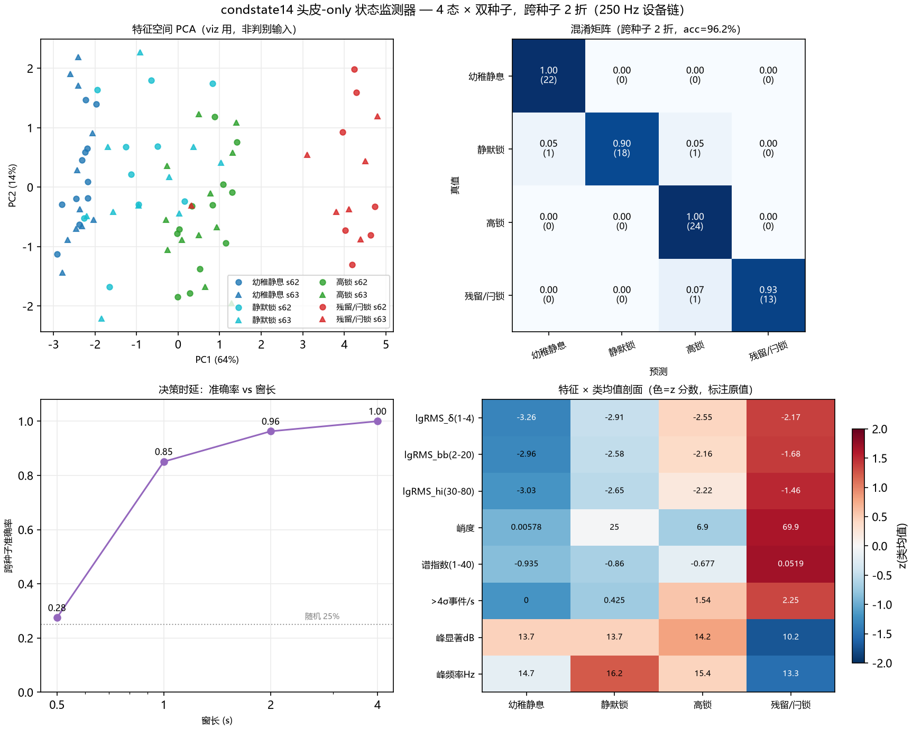
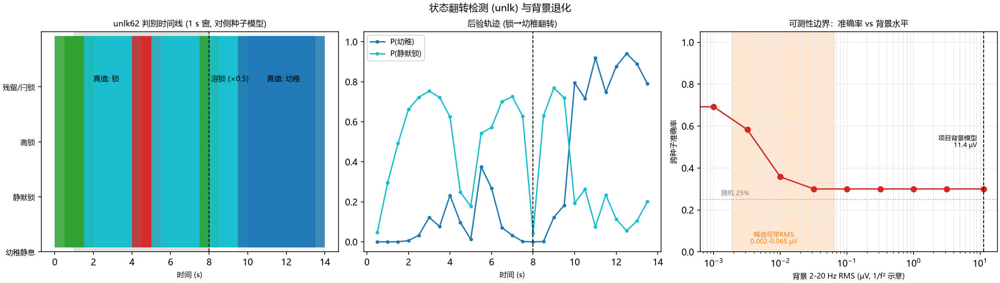

# bci/condstate14：头皮-only 状态监测器——四态判别、翻转检出与可测性边界

condstate12/13 提出"事件检测应由状态读出门控"，但项目里从未有
一个真正能用的状态判别器。本弧把 eegview 相似度审计验证过的特征
（带 RMS / 峭度 / 谱指数 / >4σ 事件率）接成 **4 类监督判别器**，
全部数据盘上现有（零采集，condstate2/3/4 头皮导出，双种子 62/63）：

| 类 | 臂 | 稳态窗 (ms) | 内部状态 |
|---|---|---|---|
| naive 幼稚静息 | condstate3 ctl | [4000,16500] | 池全静默 |
| qlock 静默锁 | condstate2 lock | [3000,14000] | ALPN ~20 Hz |
| hlock 高锁 | condstate4 hl | [3000,16500] | ALPN ~100 Hz |
| resid 残留/闩锁 | condstate3 res | [8000,16500] | AL 99 + KC/MBON 招募 |

特征 **8 维、严格头皮-only**（不触碰 pop npz）：δ(1-4)/bb(2-20)/
hi(30-80) 带 RMS（log）、峭度、谱指数（1-40 Hz Theil-Sen）、>4σ
事件率、共模峰显著 dB、峰频率。设备链同 eegview（1 kHz →
0.5-100 Hz → 250 Hz）。分类器：多项逻辑回归，**跨种子 2 折**
（训 62 测 63 + 反之）；状态标签来自协议臂（监督训练标签）。

## 结果（outputs/）




### 1. 四态判别：2 s 窗跨种子 96.3%，复证 100%

80 段（4 态 × 双种子 × 2 s 窗 / 1 s 步）跨种子合并：**acc 96.3%**
（naive 100% / qlock 90% / hlock 100% / resid 92.9%）；对完全
独立 trial 的幼稚复证（condstate2 ctl）**100%**。混淆矩阵仅 3 错，
**全部落在相邻深度态**（qlock→naive、qlock→hlock、resid→hlock
各 1）——从不跨深度轴（naive↔resid 零混淆）。判别来源清晰：

| 特征 | naive | qlock | hlock | resid |
|---|---|---|---|---|
| lgRMS 2-20 | −2.96 | −2.58 | −2.16 | −1.68 |
| 峭度 | 0.0 | 25.0 | 6.9 | 69.9 |
| 谱指数 | −0.94 | −0.86 | −0.68 | +0.05 |
| >4σ 事件/s | 0.0 | 0.43 | 1.54 | 2.25 |

带 RMS 沿深度轴单调（幅值阶梯）；峭度/事件率给出形态指纹；
谱指数随深度单调变平。逻辑回归权重：qlock 主要吃幅值特征、
hlock/resid 主要吃峭度+事件率。

### 2. 决策时延：≥2 s 才可用，0.5 s 全瞎

| 窗长 | 0.5 s | 1 s | 2 s | 4 s |
|---|---|---|---|---|
| acc | **0.275** | 0.851 | 0.963 | **1.000** |

0.5 s 窗掉到随机水平（峭度/谱指数在 125 样本上估计不稳）；1 s
85%；4 s 完美。**状态读出需要秒级积分窗**——与 eegview 的
4-16 ms 去相关时标对照，这是群体统计量（不是单事件）的代价。

### 3. 状态翻转检出：unlk 溶锁可从头皮单独读出

condstate2 unlk 臂（8 s CEN_C ×0.5 溶锁）时间线，1 s 窗、对侧
种子模型：熔断前误报幼稚 0%/7%，**翻转检出延迟 +2.0 s**（首个
"此后全幼稚"窗的中心时刻 − 8 s，即窗效约 1.5-2 s，与时延表
自洽）。后验轨迹 P(静默锁)→P(幼稚) 在 8-10 s 干净翻转。这是
项目里第一次证明**状态转换本身可从头皮单独读出**——门控事件
检测所需的读出通道在原理上成立。

### 4. 可测性边界：读"状态"需要亚 nV 背景

在 2 s 窗判别器上叠 1/f² 示意背景（85% 共享，2-20 Hz RMS=σ；
训练于干净信号、测试于退化信号）：

| σ_bg | 0 | 1 nV | 3.2 nV | 10 nV | ≥32 nV |
|---|---|---|---|---|---|
| acc | 0.963 | 0.692 | 0.583 | 0.358 | 0.300（地板） |

**膝盖在 1-10 nV**——蝇信号自身带 RMS 才 2-65 nV，即背景只要
与被读状态同量级，四态信息就淹没；项目背景模型 11.4 µV 下
完全随机。主论点从"事件不可测"升级为"**连状态本身都不可测**"：
任何真实头皮设备的背景 ≥0.1 µV，比可读预算差 1-2 个量级。

## 语义

- 状态监测器（头皮-only）在**干净仿真内**完全可用：96-100%、
  秒级时延、翻转可检出——condstate12/13 要的门控读出有了实体。
- 同一个监测器在**设备现实**下不可用：可测性预算 ~1 nV，与
  11.4 µV 背景差 4 个量级。"变蝇人"的正向读出在原理层成立、
  在工程层被背景封死——这是主论点的状态级版本。
- 判别特征 = eegview 审计的"不像"特征本身（峭度、平谱、事件率）：
  **不像人脑的指纹恰恰是状态可分性的来源**——两弧互相咬合。

## 诚实边界

- 监督标签来自协议臂（非盲）；4 态 × 2 种子 × 8 维特征，样本
  小（80 段），未做特征数惩罚的严格估计（8 维 vs 40 段/折，
  逻辑回归在 4 s 窗的 1.000 有过拟合风险——但 2 s 窗 80 段下
  96.3% 与复证 100% 支持结论稳健）。
- unlk 延迟 2.0 s 受窗长分辨率限制（1 s 窗 + 步 0.5 s），真实
  翻转动力学的分辨率未测更细。
- 背景为示意模型（同 eegview 复合行），非真实设备噪声谱；
  地板 0.300 = 多数类先验，不是 0.25 均匀随机。
- res/hl 臂的稳态窗避开了 17-19 s 训练窗；监测器未在
  "训练脉冲进行中"的混合时段上评测（那是另一个问题：事件
  vs 状态的解耦，见 condstate12）。

## 复现

```bash
# conda ffbm, repo root
python bci/condstate14/state_monitor.py
# -> outputs/monitor_main.png, outputs/monitor_unlk_bg.png,
#    outputs/monitor_stats.json
```
