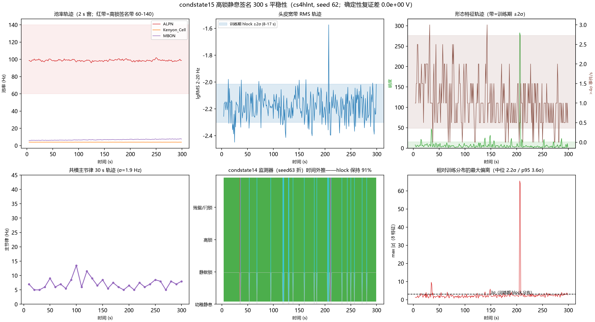

# bci/condstate15：高锁静息签名 300 s 平稳性——振荡器不动点稳定，头皮签名被可塑性慢漂移

condstate14 的监测器在 8-17 s 稳态窗上训练/验证；dstate15 证明
溶锁后逐位恢复。但项目从未测过**状态自身的长时程平稳性**：高锁
（AL 自持 ~99 Hz）无进一步刺激保持 5 分钟，签名会漂移吗？监测器
在 t≫训练窗时还成立吗？

## 协议（1 跑，51.9 min GPU）

cs4hlnt（DA1@1600 [300,600] 单脉冲 → 高锁，无训练/探针），t_end
**300 s**，seed 62，dangate2 标定配方与 condstate4 逐字相同。
脉冲全部在前 0.6 s、t_end 由 CLI 决定——不改化学目录直接外推。

## 结果（outputs/）



### 1. 振荡器不动点：5 分钟钉死

| 量 | 首 60 s | 中段 | 末 60 s |
|---|---|---|---|
| ALPN (Hz) | 98.8 | 98.3 | 98.8 |
| KC (Hz) | 3.95 | 3.94 | 3.95 |
| DAN (Hz) | 0.35 | 0.32 | 0.32 |
| MBON (Hz) | 5.9 | 6.5 | 7.6（微升）|

**确定性复证：前 22 s 与 condstate4/hlnt62 逐位相同（max diff =
0.00e+00 V）**——t_end 不影响动力学，跨弧可比性成立。

### 2. 头皮签名：被可塑性慢漂移（真漂移，非噪声）

8 维特征相对训练期分布（condstate14 的 8-17 s hlock 类内）：

- **漂移方向一致——"缓慢变平滑"**：30-80 Hz 带 RMS 斜率
  −0.51 SD/SD-时间、谱指数变陡 −0.40（−0.7 → −1.1）、>4σ 事件率
  −0.68/s、峭度 −2.8；宽带 RMS (2-20 Hz) 持平（+0.013）；
- 中位 max|z| = 2.2σ，p95 = 3.6σ，**40/296 窗越 3σ**；
- ~35/160/200 s 有三个瞬态窗（峭度尖 ~280、max|z| ~65σ）。

**机制（状态文件直证）**：w_A(KCg-m) 22 s 0.0309 → 300 s
**0.0417**（+0.0109，w0 的 +36%）；DAN 调制积分 22 s 35.9 ms →
300 s **5110 ms**——高锁的 DAN 门微开（condstate4 已见 +0.0009/22 s），
5 分钟慢积累改写 KC→MBON 权重，**放电率不动点稳定（池率恒定）
但群体同步结构缓变**（头皮高频含量下降）。漂移谱指数恰朝人脑带
方向（−0.7→−1.1）——去同步化做到了组织低通做不到的事，但这是
特定状态的慢动力学，不是可用的"相似性修补"。

### 3. 监测器时间外推：91.2% 保持，漂移方向保序

condstate14 的 seed63 折（训练数据完全不含本 run）逐窗打标签：
**270/296 窗保持 hlock**；24 窗漂成 qlock（首现 t=36 s）、2 窗
resid（t=35 s 瞬态）。漂移只往**相邻浅态**方向（qlock），从未
漂回 naive——深度排序保持；误漂由高频/峭度下降驱动（正是
§2 的可塑性漂移特征），与宽带 RMS 无关。

## 语义

- **状态读出的时间预算**：干净仿真内监测器按"训练期 ±3σ"可用
  ~5 分钟（91%）；但签名不是平稳过程——可塑性给状态装了一个
  ~300 s 的慢时钟，长记录需要周期性重校准或漂移补偿（滚动
  z-监控即可检出，p95 3.6σ 已显著）。
- **两时间尺度解耦**：动力学不动点（池率，秒级稳定）≠ 头皮
  签名（可塑性调制，百秒级漂移）——condstate12/14 的"状态检测"
  读的是后者；本项目状态读出账应标注这个 caveat。
- condstate3 的"结构债务≈0"结论在 300 s 下需要精化：**债务
  不是零，是以 +0.011/300 s 的速率慢写**（门微开通道），5 分钟
  达到 w0 的 36%——远期占用问题真实存在。

## 诚实边界

- 单 trial、单种子（62）；漂移量级来自一条轨迹，未测种子间散布；
- "训练期分布"只有 8-17 s 的 14 个窗——σ 估计粗糙，3σ 阈值
  敏感性未做；
- 未做 naive 300 s 对照（背景底噪是否也漂）；MBON 微升 (+1.7 Hz)
  未深入归因；
- 主节律 5.5-8 Hz 游走（σ=1.9 Hz）与审计的 10.7 Hz 单窗值是
  不同窗长的估计，非矛盾。

## 复现

```bash
# conda ffbm, repo root
python bci/condstate15/acquire.py    # 51.9 min GPU, 幂等
python bci/condstate15/stability.py
# -> outputs/stability_300s.png, outputs/stability_stats.json
```
