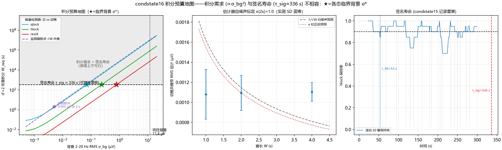

# bci/condstate16：积分预算地图——积分-漂移不相容，状态读出的可测性总账

## 问题

condstate12/14 给出状态检测的背景账（2 s 窗监测器膝点 ~0.005 µV、
11.4 µV 下纯随机）；condstate15 给出签名寿命（可塑性慢漂移）。
最后一个未回答的问题：**积分能不能把可测性买回来？**——背景越强
按 √W 收敛需要越长积分，但签名自己只在分钟尺度内成立。两个约束
是否留有任何可行窗口？

## 方法（零采集）

- **检测侧（能量检测器，共模 2-20 Hz 带 RMS，与 eegview/审计
  同口径）**：d'(W, σ_bg) = s / σ_est，σ_est² = [(κ·σ_naive)² +
  σ_bg²]/(B·W)，B=18 Hz；s = 态-幼稚带 RMS 差（实测）；κ = 估计器
  自噪声校正（幼稚信号逐窗 RMS 涨落 vs 白噪声 1/√(BW) 预测，
  实测 **κ≈0.95**——√W 模型在干净仿真上成立）。
- **监测器锚点**：condstate14 实测膝点（0.005 µV @ 2 s）按
  σ_knee ∝ √W 外推，作为多特征检测器参照线。
- **漂移侧**：τ_sig = 3σ / 8 维特征联合漂移速度（condstate15
  斜率，v ≈ 0.0089 SD/s）→ **336 s**；另报 τ_90 = 53 s（滚动
  保持率 <90% 的保守运营值）。

## 结果（outputs/）



### 1. 信号强度与临界背景

| 态 | s = 态−幼稚 (µV) | σ*（τ_sig 内可读的最大背景）|
|---|---|---|
| qlock 静默锁 | 0.0018 | 0.070 µV |
| hlock 高锁 | 0.0060 | 0.233 µV |
| resid 残留/闩锁 | 0.0200 | **0.777 µV** |

### 2. 不相容：11.4 µV 下需要小时-月级积分，签名只有分钟

| 检测器 | 11.4 µV 下所需 W_req | vs τ_sig=336 s |
|---|---|---|
| 能量检测器 resid（最强态）| **18.7 h** | ×200 超限 |
| 能量检测器 qlock | 2289 h | ×24,000 |
| 监测器（多特征，√W 外推）| 2888 h | ×31,000 |

即使把 τ_sig 放宽到 336 s（宽估：τ_90 只有 53 s），监测器
膝点在 τ_sig 内也只能推到 **0.065 µV**。**两套独立检测模型一致：
不存在同时满足"积分够长"与"签名还在"的窗口。**

### 3. 语义

- **这不是电子学问题**：实验室级放大器带内噪声 ~0.1 µV 量级，
  已接近 resid（最强态）的 σ*=0.78 µV——硬件差一步能到；不可约
  的是**人脑头皮背景本身**（11.4 µV），差 15-160×。
- **主论点的第四层闭环**：condstate12（事件不可测）→ condstate14
  （状态在干净仿真内可读、设备下膝点 1-10 nV）→ condstate15
  （签名寿命分钟级）→ **本弧：积分被签名寿命封顶，任何算法/
  任何积分策略都无法同时满足两个约束**——"变蝇人"正向读出在
  信息层被封死，不是工程优化问题。
- √W 外推假设窗间独立；自噪声侧 κ≈0.95 支持该假设，背景项为
  合成高斯（真实人脑背景长程相关只会更差——外推方向保守）。

## 诚实边界

- 能量检测器是单特征保守下界，监测器参照线是实测锚点的外推
  （未实测 >2 s 的膝点）；两条线都不可行，结论对外推细节稳。
- τ_sig 来自单 trial（hlock）斜率线性外推；resid 的漂移速率
  未测（其状态更深、DAN 门更关，漂移可能更慢——对结论有利
  方向）；τ_90=53 s 提示实际运营预算更紧。
- s 单种子（62）；窗口选择必须避开各臂训练/探针段——首版 naive
  窗误含 [17,19] s 训练脉冲，RMS 虚高 15×、κ 假象 ~10（已修），
  与 eegview/condstate14 口径复核一致后定稿。

## 复现

```bash
# conda ffbm, repo root
python bci/condstate16/budget_map.py
# -> outputs/budget_map.png, outputs/budget_stats.json
```
