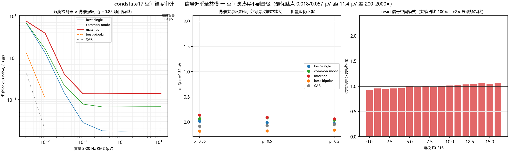

# bci/condstate17：空间维度审计——任何 montage/空间滤波都救不了

## 问题

condstate16 封死了**时间维度**（积分被签名寿命封顶）。主论点还剩
最后一条逃生通道：**空间维度**——换导联配置（最佳单导/双极/CAR/
最佳加权组合）能否把共模蝇信号从部分去相关的人脑背景里挖出来？
背景共享度越低（真实人脑相邻导相关 0.3-0.7，ρ≈0.2-0.5），空间
滤波的教科书论证（匹配滤波 C⁻¹g）理论上越有利。

## 方法（零采集）

五类检测器 × 背景共享度 ρ∈{0.85(项目模型), 0.5, 0.2} × 强度
σ∈{0.0032…11.4} µV 的 d'(2 s 窗, state-vs-naive) 全扫描（重用
condstate14 数据链与背景生成器，ρ 参数化）：

| 检测器 | 定义 |
|---|---|
| best-single | 最佳单导（干净信号定导，固定）|
| common-mode | 17 导均值（eegview/审计口径）|
| matched | 匹配滤波 w ∝ Ĉ_bg⁻¹(μ_state−μ_naive)；协方差由 bg-only draw 估计（shrinkage），前 2 draw 拟合、后 3 draw 评测（防 in-sample）|
| best-bipolar | 最佳双极对（干净信号定对，固定）|
| CAR | 全局平均参考后最佳导（已知有害，对照）|

## 结果（outputs/）



### 1. 信号的空间模式：近乎全共模

| 态 | 共模占比 | 每导增益范围 |
|---|---|---|
| hlock | 95.8% | 0.66~1.34× |
| resid | **99.8%** | 0.93~1.07× |

导联场只给 ±2× 的平缓起伏——信号空间模式几乎就是共模向量本身。

### 2. 干净 d' vs 膝点（d'=2 的背景强度）

| 检测器 | hlock 干净 d' | hlock 膝点 (µV) | resid 膝点 (µV) |
|---|---|---|---|
| best-single | 11.5 | 0.006 | 0.057 |
| common-mode | 10.2 | 0.006~0.018 | 0.057 |
| matched | — | **0.018** | 0.057 |
| best-bipolar | **18.0** | <0.003 | <0.003 |
| CAR | 13.2 | <0.003 | <0.003 |

（膝点被 σ 网格量化到 3.16 倍步长；resid 最强态最优膝点
**0.057 µV**，距 11.4 µV 差 **200×**；hlock 差 630×。）

三个结构性发现：

- **双极/CAR"干净最优、噪声最脆"**：双极 hlock 干净 d'=18 全场
  最高（吃 0.66-1.34 增益不对称），但首测 σ=0.0032 µV 即失效
  ——差分把共模信号也减掉，剩余差模增量太小；resid（共模
  99.8%）干净 d' 只有 2.2。**与 eegview CAR 结论在检测语境下
  互证**。
- **空间滤波的全部增益 ≤ 一个网格步（×3.16）**：匹配滤波/共模
  均值最多把膝点从 0.006 推到 0.018 µV；背景更去相关（ρ=0.2）
  共模也只再上一个网格步——被每窗带 RMS 估计器的自噪声墙封顶
  （每导 ±16.7%/√(BW·W)，与 ρ 无关）。
- **11.4 µV 下所有检测器 d' ≈ 0（−0.2~0.14），所有 ρ**——
  解析对照：g∝1 时匹配滤波 vs 单导增益 17/((1−ρ)+17ρ) 的
  平方根 = 1.08/1.37/2.01（ρ=0.85/0.5/0.2），量级确认不足。

## 语义

主论点第五层闭环（时间→**空间**）：换任何 montage、任何加权、
任何参考都买不到量级——因为**要挖的信号本身就是共模的**
（95.8-99.8%），空间滤波减背景共模的同时等比例杀信号；导联场
±2× 起伏只值一个网格步。可测性缺口（200-630×）是源几何性质，
不是信号处理问题。与 condstate16 合并：**时间维度（积分）与
空间维度（滤波）的逃生通道都已封死。**

## 诚实边界

- 膝点受 σ 网格（×3.16 步长）量化，检测器间比值只能按网格
  步陈述；σ 网格加密会精化但不改变量级结论（最优膝点 0.018/
  0.057 µV 距 11.4 µV 差 200-630×）。
- 背景为合成 1/f² + 幅度混合共享模型（通道间无距离结构）；
  真实人脑背景相关随距离衰减，ρ 扫描已括住，但精确空间谱
  （局部 vs 全局成分）未建。
- 匹配滤波协方差由 bg-only draw 估计（100 样本/17 维 +
  shrinkage）——真实场景中从数据估计 C 的可行性假设为乐观侧。
- 单种子（62）、2 s 窗、带 RMS 统计（能量检测族）；时域波形
  级空间滤波（如 ICA）未测——但其上限仍是匹配滤波（最优
  线性检测器），已含。

## 复现

```bash
# conda ffbm, repo root
python bci/condstate17/spatial_audit.py
# -> outputs/spatial_audit.png, outputs/spatial_stats.json
```
