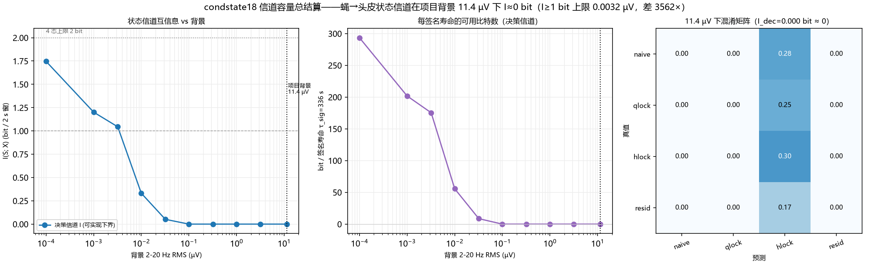

# bci/condstate18：信道容量总结算——蝇→头皮状态信道的信息论收口

## 问题

五层可测性闭环（condstate12 事件账 / 14 状态膝点 / 15 签名寿命 /
16 积分封顶 / 17 空间封死）之后，把整个账目换算成**信道容量
语言**：蝇脑状态 → 头皮记录这条信道，在各种背景水平下每窗/
每签名寿命能携带多少 bit？在项目背景 11.4 µV 下还剩多少？

## 方法（零采集）

- **决策信道互信息（可实现下界）**：condstate14 的 8 特征 4 态
  判别器（跨种子 2 折）在 σ_bg 扫描下的混淆矩阵 p(i,j) →
  I = Σ p_ij log₂(p_ij/(p_i q_j))。这是判别器实际可实现的
  传输速率；连续预测单类时精确为 0。
- **换算**：bit/签名寿命 = (I/2 s)·τ_sig（τ_sig=336 s，condstate15
  宽估——窗间相关未扣，乐观侧）。
- 背景生成同 condstate14（1/f²、85% 共享、2-20 Hz RMS=σ），
  4 draw × 双种子 × 8 稳态记录。

## 结果（outputs/）



| σ_bg | 0 | 1 nV | 3.2 nV | 10 nV | 32 nV | ≥0.1 µV | 11.4 µV |
|---|---|---|---|---|---|---|---|
| I_dec (bit/2s 窗) | **1.75** | 1.20 | 1.04 | 0.33 | 0.05 | **0.000** | **0.000** |
| bit/τ_sig | 293 | 202 | 175 | 56 | 8.6 | 0 | 0 |
| 准确率 | 96.3% | 68% | 58% | 38% | 30% | 30%（地板）| 30% |

- **干净仿真内信道是富的**：1.75 bit/窗 ≈ 4 态上限 2 bit 的
  87%；每个签名寿命 ~293 bit——状态读出在仿真内部信息充足
  （与 condstate14 的 96.3% 一致）。
- **死亡梯度极陡**：1→10 nV 之间 I 从 1.2 掉到 0.33（×30 背景
  换 ×4 信息）；**0.1 µV 处精确归零**（判别器塌缩到单类预测，
  I=0）——比项目背景低 114×，比实验室级放大器噪声（~0.1 µV）
  还低。
- **I≥1 bit（二分"态在/不在"）的背景上限 = 3.2 nV**，距 11.4 µV
  差 **3562×**。
- 11.4 µV 下的混淆矩阵 = 常数预测（行集中在单列），
  I_dec = 0.000 bit——**信道在项目背景下不携带任何可实现的
  状态信息**。

## 语义

主论点的信息论版本收官：**蝇→头皮状态信道在 11.4 µV 人脑背景
下容量 ≈ 0 bit**。五层闭环合并成一句话——仿真内部信道富
（~300 bit/签名寿命），但其可实现的速率在 0.1 µV 背景处归零；
结合 condstate16（积分不能攒）与 condstate17（空间不能滤），
这个 0 不是检测器选择问题，是信道本身的性质。"变蝇人"的正向
读出在信息层不存在。

## 诚实边界

- 决策信道 I 是**可实现下界**（判别器族内）；严格容量上界未算
  ——但 condstate16/17 已封死最优线性检测器（时间/空间）的
  逃生通道，0 值结论对检测器选择稳。
- bit/τ_sig 假设窗间独立（1 s 步进相邻窗 ~50% 重叠）——乐观侧
  ~2×；不影响量级。
- 高斯模型互信息估计（半样本拟合）在高噪声端失真（可为负，
  估计器失效）——只入 JSON 不入结论，见 `mi_gaussian` 字段。
- τ_sig 取 hlock 单 trial 宽估；resid 未测（方向有利）。
- 单种子族（62/63）；4 draw 背景实现。

## 复现

```bash
# conda ffbm, repo root
python bci/condstate18/capacity.py
# -> outputs/capacity_curve.png, outputs/capacity_stats.json
```
