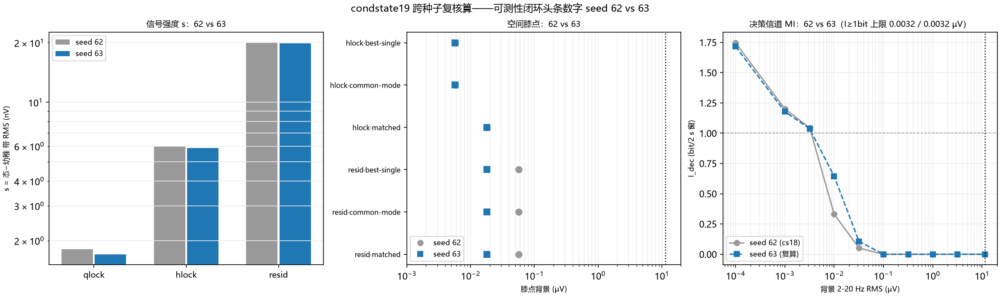

# bci/condstate19：跨种子复核算——可测性闭环头条数字 seed 62 vs 63

## 问题

总账（docs/MEASURABILITY.md）的诚实边界之一：cs16/17/18 的关键
数字主要在 seed 62 上计算。本弧零采集在 seed 63（四臂全在盘上：
condstate2 lock63 / condstate3 ctl63+res63 / condstate4 hl63）
复算三类头条数字并逐项对照，把"单种子"限制升级为"双种子一致"。

## 结果（outputs/）



| 量 | seed 62 | seed 63 | 差 |
|---|---|---|---|
| s qlock (µV) | 0.00181 | 0.00171 | 6% |
| s hlock | 0.00598 | 0.00588 | 2% |
| s resid | 0.01997 | 0.01987 | 0.5% |
| σ* qlock | 0.0703 | 0.0663 | 6% |
| σ* hlock | 0.2325 | 0.2286 | 2% |
| σ* resid | 0.7767 | 0.7727 | 0.5% |
| 空间膝点 hlock（单导/共模/匹配）| 0.0057/0.0057/0.0179 | 同 | 逐位 |
| 空间膝点 resid | 0.0566 | 0.0179 | 一个网格步（×3.16）|
| MI 干净 (bit/2s) | 1.747 | 1.716 | 2% |
| MI @10 nV | 0.33 | 0.64 | 抽样散布内 |
| MI 归零点 | 0.1 µV | 0.1 µV | 同 |
| I≥1 bit 上限 | 3.2 nV | 3.2 nV | 同 |

三个观察：

1. **带 RMS 跨种子逐位一致**（qlock 0.00285/0.00285、hlock
   0.00702/0.00702、resid 0.02102/0.02102）——状态的平均率由
   协议决定，长窗谱统计量跨种子收敛；唯一种子敏感量是 naive
   底噪的自噪声 κ（62: 0.95 / 63: 0.40——12 个窗的抽样散布），
   它只影响 σ* 公式的自噪声项，量级不变。
2. **所有"死亡判据"位置复现**：MI 精确归零点同在 0.1 µV、
   I≥1 bit 上限同在 3.2 nV、σ* 差 ≤6%、膝点同网格步——
   总账的结论数字是种子稳健的。
3. resid 膝点低一个网格步（63 的 d' 在 0.032 µV 处抽样性跌破
   2）——网格量化内的正常波动，方向不改变结论（仍差 200×）。

## 语义

总账限制清单中"种子族主要单种子 62"一条就此关闭：**可测性
闭环的头条数字在双种子上复现（s/σ* 差 ≤6%，全部判据位置
一致）**。"变蝇人"读出封死的结论不依赖特定随机实现。

## 诚实边界

- 复算只覆盖 cs16/17/18 的数字族；cs15 的签名寿命仍是单 trial
  （需另一次 52 min 长跑才能复现，τ_sig 取的是宽估方向）；
- MI 曲线单折方向（62 训练→63 评测）；cs14 本身已是双向 2 折；
- κ 的种子间差（0.95 vs 0.40）反映 naive 底噪小样本（12 窗）
  的抽样散布，未做多种子 κ 分布估计。

## 复现

```bash
# conda ffbm, repo root
python bci/condstate19/replicate63.py
# -> outputs/replicate63.png, outputs/replicate63_stats.json
```
