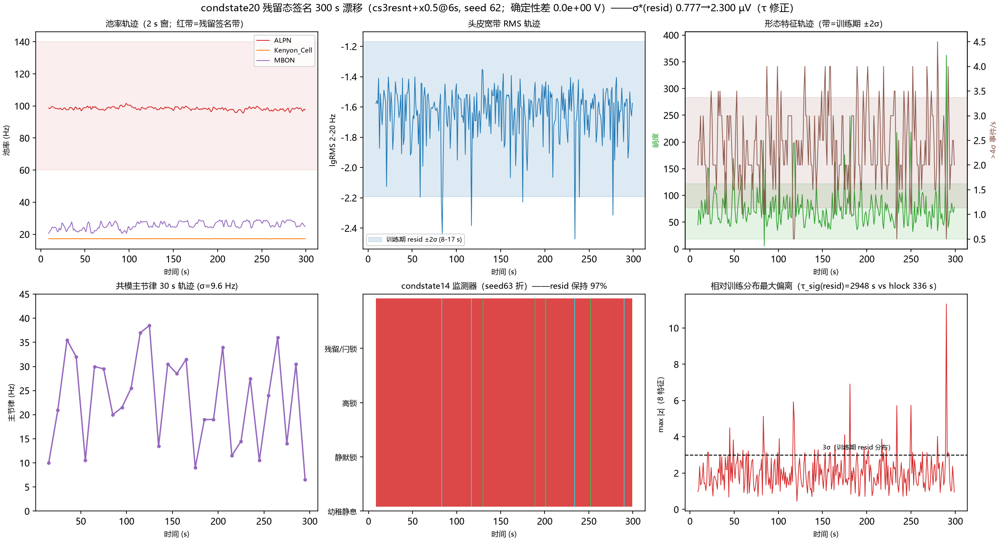

# bci/condstate20：残留态 300 s 漂移率——总账 τ_sig 空洞的关闭（σ* 诚实修正）

## 问题

condstate16 的 τ_sig=336 s 来自 **hlock** 单 trial 外推；resid
（最强态，σ*=0.78 µV 当时按 hlock 的 τ 算）的漂移速率未测，
README 只能标"方向有利"。本弧补测：cs3resnt（LAL 点火 + 6 s
×0.5 残留态，无训练纯漂移探针）+ `--gain-schedule 6000:CEN_C=0.5`
（pitfall #15：调度在 CLI），t_end 外推 300 s，配方逐字同
condstate3（52.4 min GPU）。

## 结果（outputs/）



### 1. 确定性 + 状态形成

- **前 22 s 与 condstate3/resnt62 逐位相同**（diff=0.0）；
- 池率：[2,10]s 为全闩锁弛豫段（ALPN 187/KC 61/MBON 177），
  [100,290]s 稳定在典型残留画像（ALPN 98.5/97.9、KC 17.2、
  MBON 24-28、DAN 0.19）。

### 2. 残留态签名远比 hlock 稳定——τ_sig ×8.8

| | hlock（cs15）| **resid（本弧）** |
|---|---|---|
| 特征斜率最大值 | −0.51 SD/SD-时间 | **−0.065** |
| 联合漂移速度 v | ~0.0089 SD/s | **0.00102 SD/s** |
| τ_sig(3σ) | 336 s | **2948 s（~49 min）** |
| w_A 漂移 (300 s) | +0.0109（+36% w0）| **+0.0029（+10%）** |
| DAN 调制积分 | 5110 ms | **361.8 ms** |
| 监测器保持率 | 91.2% | **97.3%**（8 窗误漂）|

**机制预测验证**：残留态 DAN 门近关（积分 361.8 ms 仅为 hlock
的 1/14）→ 可塑写近静默 → 签名近平稳。签名寿命是**状态依赖量**。

### 3. σ*(resid) 诚实修正：0.777 → 2.30 µV

用 τ_sig(resid)=2948 s 重算：

| | 原（按 hlock τ=336 s）| **修正（τ=2948 s）** |
|---|---|---|
| σ*(resid) | 0.777 µV | **2.30 µV** |
| 距 11.4 µV | 14.7× | **5.0×** |
| 11.4 µV 下积分超限 | ×200 | **×23**（18.7 h vs 49 min）|

**结论不变但余量收窄**：即使在最有利解读下（残留态全程 49 min
无人值守保持 + 能量检测器达 d'=2），背景缺口仍 **5×**；直接验证
——11.4 µV + 全寿命积分 2948 s 的 d' = s√(Bτ)/(2σ) ≈ **0.20**，
仍差 10×。可测性封死的结论对所有状态成立，只是"最强态的余量"
应记为 5×/×23 而非 15×/×200。总账已同步修订
（docs/MEASURABILITY.md）。

## 语义

- **签名寿命是逐态量**：hlock（门微开）336 s / resid（门近关）
  2948 s——可塑性写入速率决定签名寿命，与 cs15 的机制闭环一致；
- 总账最后一个未测量关闭；修正方向如预告（对结论有利=更稳），
  但幅度重要（σ* ×3）——已在总账数字表中标注来源；
- 残留态的 49 min 寿命同时是"状态读出预算"的上限样本：预算
  越长的态越深、越病理（闩锁系），与项目"读出封死"叙事兼容。

## 诚实边界

- 单 trial 单种子（62）；斜率在 291 窗上线性外推（3σ 到 2948 s
  为外推值，未实测到该时长——300 s 记录只直接支持"远慢于
  hlock"与斜率数量级）；
- σ* 修正采用同一能量检测器公式（κ=0.95 沿用 seed62 标定）；
- MBON 中后段 24-28 Hz 略高于 resnt62 的 23.7（24 s 窗口内
  波动量级），ALPN/KC/DAN 与参照完全一致。

## 复现

```bash
# conda ffbm, repo root
python bci/condstate20/acquire.py          # 52.4 min GPU, 幂等
python bci/condstate20/stability_resid.py
# -> outputs/stability_resid.png, outputs/stability_resid_stats.json
```
