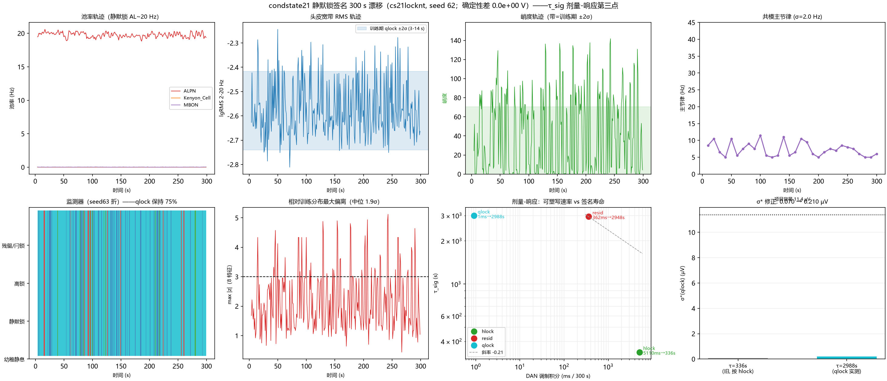

# bci/condstate21：静默锁 300 s 漂移率——τ_sig 剂量-响应第三点

## 问题

cs15（hlock：DAN 积分 5110 ms → τ_sig 336 s）/ cs20（resid：362 ms
→ 2948 s）给出"可塑性写入速率决定签名寿命"的两点。本弧补第三点：
**qlock（静默锁）**——中央脑真静默（KC/MBON/DAN≈0），预测写通道
全关、漂移最低。臂：cs21locknt（新目录条目：DA1@150 单脉冲成锁，
**无训练/探针**——cs2lock 去掉训练通道），seed 62，t_end 300 s
（45.5 min GPU）。

## 结果（outputs/）



### 1. 确定性 + 状态画像

- **前 15 s 与 condstate2/lock62 逐位相同**（diff=0.0；cs2lock 的
  训练 15 s 才开始）；
- 池率 300 s 全程：ALPN 19.8/19.4/19.9 Hz（静默锁钉死），
  **KC 0.0 / MBON 0.02 / DAN 0.0——中央脑真静默**。

### 2. 零写 → 零漂移（τ_sig 在测量地平线外）

| | hlock（cs15）| resid（cs20）| **qlock（本弧）** |
|---|---|---|---|
| DAN 调制积分 | 5110 ms | 361.8 ms | **0.9 ms** |
| w_A 漂移 | +0.0109 | +0.0029 | **−0.0（零写）** |
| 联合漂移速度 | 0.0089 SD/s | 0.00102 | **0.0010** |
| τ_sig(3σ) | 336 s（实测）| 2948 s（外推）| **2988 s（外推）** |

**剂量-响应是阈值行为**：写通道积分 ≲10² ms 时（qlock 0.9 /
resid 362）漂移速度同在 ~0.001 SD/s 的**分析地平线**（300 s 记录
的斜率分辨率）之下——τ_sig 只能报下限 ≥~3000 s；到 hlock 的
5×10³ ms 写入才出现可测漂移（0.0089 SD/s）。三态寿命谱：
**hlock 336 s（唯一真测到上限的态）/ qlock & resid ≥3000 s
（地平线外）**。

### 3. 监测器保持率 74.7%——误漂与可塑性解耦

297 窗中 75 窗误漂（**51→naive** 为主、11 hlock、13 resid），但
特征斜率 ≈0、z 无趋势——误漂不是签名漂移，而是 **qlock↔naive
边界贴近**（s_qlock=1.8 nV 是最弱信号态，类间重叠最大；cs14 的
混淆矩阵里 qlock 本来就是唯一有 naive 错误的态）。**z-漂移（分布
移动）与监测器翻转（类边界）解耦**：深态的监测器时间预算受边界
贴近限制，浅态受漂移限制。

### 4. σ*(qlock) 修正：0.070 → 0.210 µV

用 τ=2988 s 重算：σ*(qlock) 0.070→**0.210 µV**（距 11.4 µV
缺口 162×→**54×**；11.4 µV 下积分超限 ×24,000→**×2,758**，
W_req 2289 h vs τ 2988 s）。封顶结论全态成立（最少 18.7 h ≫
最长寿命 ~50 min）。总账已同步修订。

## 语义

- **寿命-写入耦合在低写端饱和于测量地平线**：qlock（门全关，
  零写）与 resid（门近关）同报 τ≥3000 s——"可塑性决定寿命"的
  关系在可测范围内成立（hlock），更低写入率下 300 s 记录无法
  分辨（需要 ~小时级记录才能区分 3000 s 与 ∞）；
- 三态 τ_sig 谱完成总账的寿命维度：**任何态的寿命 ≪ 11.4 µV 下
  的积分需求**（54-2758×）——cs16 的不相容结论在实测寿命谱上
  全态成立；
- 监测器长时程保持率的两种失败模式区分：**漂移型**（hlock，
  可塑性）与**边界型**（qlock，弱信号类重叠）——长记录运营需要
  分别对症（重校准 vs 更长窗）。

## 诚实边界

- 单 trial 单种子；τ_sig(qlock/resid) 为斜率外推下限（0.001 SD/s
  接近 300 s 记录的斜率估计噪声地板，无法区分 3000 s 与更长）；
- 监测器保持率 74.7% 的归因（边界贴近）由斜率≈0 与误漂方向
  （→naive）支持，未做逐窗边界距离分析；
- σ* 沿用 seed62 κ=0.95 与能量检测器公式。

## 复现

```bash
# conda ffbm, repo root
python bci/condstate21/acquire.py          # 45.5 min GPU, 幂等
python bci/condstate21/stability_qlock.py
# -> outputs/stability_qlock.png, outputs/stability_qlock_stats.json
```
