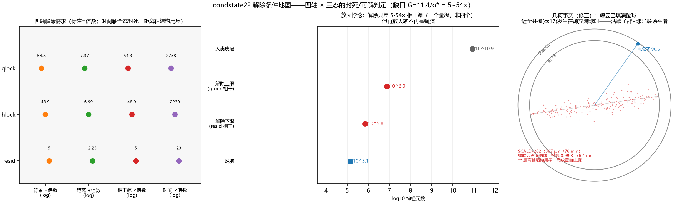

# bci/condstate22：解除条件地图——读出封死的设计空间语言

## 问题

总账（docs/MEASURABILITY.md）证明读出封死。本弧把负结果翻成
"什么能解除它"的定量地图（零采集；全部数字来自总账 json +
头模型几何 meta）：四条逃逸轴各需多大倍数，哪条物理上可达。

## 结果（outputs/）



### 1. 四轴解除需求（缺口 G = 11.4/σ* = 5.0~54.3×）

| 轴 | qlock (G=54×) | hlock (G=49×) | resid (G=5.0×) | 可达性 |
|---|---|---|---|---|
| 背景 ÷G | ÷54（静默皮层 99.97%）| ÷49（99.96%）| ÷5.0（95.9%）| ✗ 脑背景不可约 |
| 距离 ÷√G | r≤12.3 mm | r≤13.0 mm | r≤40.7 mm | **✗ 结构用尽**（源云极端已 76.4 mm；1/r² 高估）|
| 相干源 ×G | ×54（7.6×10⁶）| ×49（6.8×10⁶）| ×5.0（6.9×10⁵）| 悖论（改写思想实验）|
| 时间 ×(W_req/τ) | ×2758 | ×2239 | ×23 | ✗ 已被寿命封死 |

### 2. 放大悖论：差一个量级，不是四个

解除只需 **5-54× 相干源**——蝇 1.4×10⁵ 神经元 → 需 7×10⁵
~7.6×10⁶ 相干，仍比人类皮层 8.6×10¹⁰ 低 4 个量级。**蝇的可读性
缺口是"一个量级的悲剧"而非"四个量级的绝望"**——但补上那一个
量级（更同步/更多神经元）就已经不是"果蝇脑在人头皮下"的思想
实验了；非相干版本更差（×25~×2900）。

### 3. 距离轴：结构用尽（首版判定撤回，2026-11-15 修正）

**几何事实（fit_scale_shift 语义 + meta 实证）**：SCALE×202 把
蝇脑云放大到**极端点 0.98·R_BRAIN≈76.4 mm**（原生头 387 µm
云、长轴骑直径穿头心、宽云居中 shift=0）——**思想实验已经把
脑球填满**，没有剩余放置自由度。首版的"蝇在正心 r=90.6 mm=
深源最坏位、贴骨放置可得 25-34×"判定基于错误前提，**撤回**。

更强的实证否定：resid 的"所需 r≤40.7 mm"**已被源云极端点
（76.4 mm）满足**，而实测 σ*（已含这套几何）仍差 5×——
**1/r² 远场估计对分布式源在 4 球导体中高估收益**。距离轴对
所有态封死。

**几何再解读（保留）**：cs17 的近全共模（95.8-99.8%）**发生在
源云已充满脑球的情况下**——不是中心放置的构造伪影，而是
"活跃子群体积小 + 球形导联场平滑"的真实结果，比首版解读更强。

## 语义

- 总账的负结果有了"钥匙孔规格"：**四轴全封**（背景不可约 /
  时间超寿命 / 放大=改写思想实验 / 距离结构用尽）——思想实验
  内不存在任何物理解除通道；
- cs17 的"近全共模"结论获得更强的几何背书：源充满球仍近全共模；
- 放大悖论给"变蝇人"叙事一个精确的悲剧性数字：**差 5-54×，
  即一个量级**。

## 诚实边界

- 1/r² 为远场近似（4 球模型深源≠严格 1/r²；表面源还有切向
  分化增益——数量级判断稳健，精确倍数需核几何改动后重算）；
- G 基于 cs20/21 修正后的 σ*（τ 为外推下限的两态其 G 偏保守）；
- 静默比例按独立发生器 √f 标度（真实皮层相关性下所需静默
  更多，方向不利）；零采集弧，无新仿真。

## 复现

```bash
# conda ffbm, repo root
python bci/condstate22/unseal_map.py
# -> outputs/unseal_map.png, outputs/unseal_map_stats.json
```
