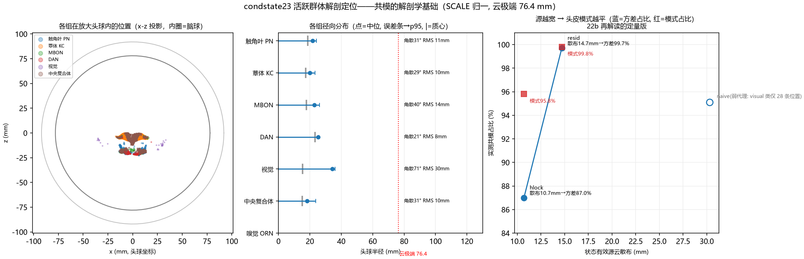

# bci/condstate23：活跃群体解剖定位——共模的解剖学基础，22b 再解读的定量版

## 问题

condstate22b 修正后的再解读"近全共模 = 活跃子群体积小 + 球形
导联场平滑"仍是推断；且"脑球被填满"与"实测仍封死"之间存在表观
张力：极端源（76.4 mm）都到皮下了为什么救不了？本弧零采集把
解剖事实挖出来：连接组注释 + 神经元坐标（ffbm.data，与导出链
同一数据源；141,781 个有位置的神经元），按云极端 = 0.98·R_BRAIN
= 76.4 mm 归一到头球坐标。

## 结果（outputs/）



### 1. 活跃群体都在中半径的紧凑子体积里

| 组 | n | 半径中位 (mm) | 质心 r | 角散布 | 空间 RMS |
|---|---|---|---|---|---|
| ALPN（触角叶 PN）| 680 | 21.7 | 18.7 | 30.7° | 10.7 mm |
| Kenyon_Cell | 4,050 | 19.9 | 17.3 | 28.8° | 9.6 mm |
| MBON | 96 | 22.9 | 17.7 | 39.5° | 13.6 mm |
| DAN | 340 | 25.2 | 23.2 | 21.4° | 8.5 mm |
| CX（中央复合体）| 2,944 | 18.2 | 15.2 | 31.2° | 10.0 mm |

**所有记录组都坐在头球中半径（质心 r≈15-23 mm = 极端的 20-30%）
的紧凑子体积里**（角散布 21-40°、RMS 8.5-13.6 mm）——填满脑球
的极端解剖（眼/外周）大多是**安静结构**；活跃引擎深居中圈。
这就解开了 22b 的表观张力：**"球被填满"不等于"源在表面"——
有效源从来都在中半径**。

### 2. 源越宽 → 头皮模式越平：两态排序验证

状态有效源云（按池率加权）：

| 态 | 有效云 | 有效散布 | 实测共模（方差/模式）|
|---|---|---|---|
| hlock | 仅 ALPN@99 | **10.7 mm** | 87.0% / 95.8% |
| resid | ALPN99+KC17+MBON22 | **14.7 mm** | 99.7% / 99.8% |

散布排序 10.7 → 14.7 mm 与共模排序 87.0→99.7 / 95.8→99.8
**同向**——"源分布越宽，导联场平均越平，共模越高"在两个可靠
态上定量成立；hlock 的相对差模丰富（0.66-1.34× 增益花纹）正
来自单组紧凑源的位置特异性。

## 语义

- 22b 再解读从推断升级为实测：**共模的解剖学基础 = 活跃引擎
  是中半径紧凑子团 + 球形导联场平滑**；
- 距离轴封死获得机制解释：填球的极端是安静解剖，活跃源质心
  r≈15-23 mm——任何"更近"都要移动功能群本身（= 改写解剖）；
- 对 likeness 纲领的回注：cs17 的"信号近乎全共模"有了解剖
  坐标——不同状态的头皮地形差异受制于各组质心间距
  （ALPN-KC-MBON 质心相距 <6 mm），远小于导联场的变化尺度。

## 诚实边界

- 云归一以全体有位置神经元的最大半径为极端（导出链的 fit 用
  group_pairs+photo 子集，质心/极端略有出入——量级不受影响）；
- naive 底的视觉类代理**不可靠**（visual 类 6,091 个中仅 28 个
  有位置条目——外周视觉缺 soma 位置），只作空心弱标记不入
  趋势；naive 底的真实发生器（外周/局部）未定位；
- 位置为原生坐标线性归一，与 fit_scale_shift 的实际平移/缩放
  在组级别可能有毫米级偏差；
- 池率加权用组均值（组内空间-速率相关未建模）。

## 复现

```bash
# conda ffbm, repo root
python bci/condstate23/anatomy.py
# -> outputs/anatomy.png, outputs/anatomy_stats.json
```
