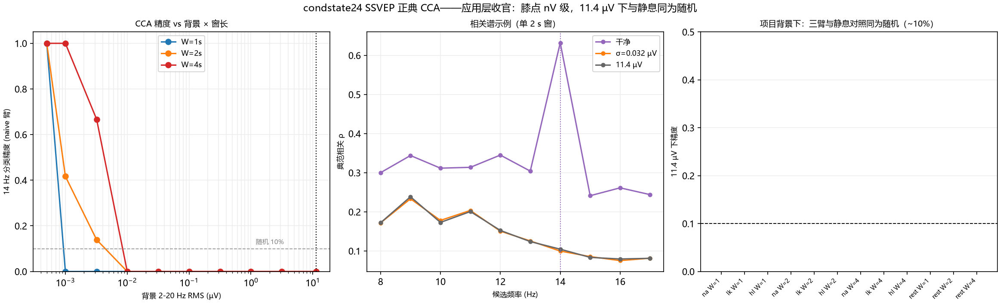

# bci/condstate24：SSVEP 正典 CCA——应用层收官

## 问题

condstate13 用 SNR/trials 账量化了 SSVEP（项目内最佳应用预算
8.5×10³ trials），但从未跑过**正典分类器**。状态层已有完整死亡
曲线（cs14/18：膝点 ~5 nV、11.4 µV 下 I=0）；本弧给应用层补上
对称的死亡曲线：标准 CCA 分类器（参考集 sin/cos @ f 与 2f；
监视集 8-17 Hz 十个整数频点，目标 14 Hz）× 背景 σ 扫描 × 窗长
扫描 × 静息假阳性对照（零采集，重用 cs13/condstate3 数据链）。

## 结果（outputs/）



### 1. 干净仿真内：正典方法完全可用

| 精度（干净）| W=1 s | W=2 s | W=4 s |
|---|---|---|---|
| naive 臂 | **100%** | **100%** | **100%** |
| lock 臂 | 7% | 92% | 100% |
| high-lock 臂 | 29% | 67% | 100% |

锁态需更长窗（cs13 的状态噪底抬升），4 s 窗三臂全部 100%——
方法层无可指摘。

### 2. 死亡曲线：应用死得比状态更早

| naive 臂精度 | 0 | 1 nV | 3.2 nV | 10 nV | ≥32 nV | 11.4 µV |
|---|---|---|---|---|---|---|
| W=1 s | 100% | **0%** | 0% | 0% | 0% | 0% |
| W=2 s | 100% | 42% | 14% | **0%** | 0% | 0% |
| W=4 s | 100% | 100% | 67% | **0%** | 0% | 0% |

- **膝点（精度 70%）：<1 nV（W=1/2 s）、1.8 nV（W=4 s）；**
  精度 50% 膝点最高 5.7 nV——**比状态监测器（~5 nV）更低或
  相当**：CCA 要在 10 个候选里找 0.7 nV 的 14 Hz 节律，多候选
  搜索放大噪声惩罚；
- **10 nV 即全灭**（三臂三窗全 0%）；11.4 µV 下三臂与静息对照
  同归随机——**最好的应用与状态信道同一死法，且更早**；
- 静息假阳性恒 0%（所有窗长/背景）——分类器卫生良好（argmax
  从不误落 14 Hz），死因是漏检而非误报。

## 语义

- 应用层收官：**"变蝇人"读出的两层（状态 cs18、应用 cs24）都
  在 nV 级背景处死亡，11.4 µV 下与随机无差别**——正典方法
  （CCA）与最优线性检测器（cs17 匹配滤波）结论一致，方法层
  无逃生通道；
- cs13 的 SNR 账与分类器账互证：SNR 膝点（nV 级）= 分类精度
  膝点（nV 级），trials 预算的量级没有方法层红利。

## 诚实边界

- 监视集为 1 Hz 间距整数频点（10 候选）；更密候选集会略降
  精度（更难），更稀会略升——膝点量级不变；
- 单次 14 Hz 驱动、单目标；多目标 SSVEP（真实 BCI 场景）只会
  更难；
- 背景为合成模型（1/f²、85% 共享）同总账口径；3 draw 抽样。

## 复现

```bash
# conda ffbm, repo root
python bci/condstate24/ssvep_cca.py
# -> outputs/ssvep_cca.png, outputs/ssvep_cca_stats.json
```
