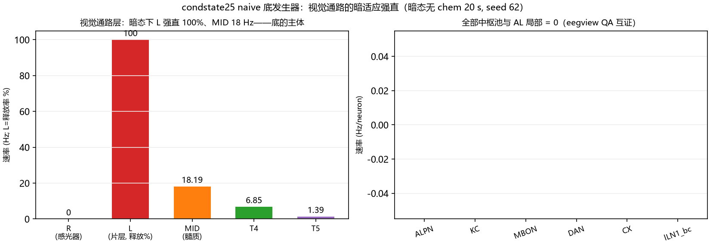

# bci/condstate25：naive 底发生器定位——视觉通路的暗适应强直

## 问题

所有缺口数字都以 naive 底为参照（s = 态−naive），但"暗态平滑底
是谁在放电"从未直接测过：eegview QA 只证明四个记录池静默；
cs23 的 visual 类代理因外周缺 soma 位置（6,091 中仅 28 有位置）
失败。本弧一次探针跑（暗态无 chem，20 s，seed 62，2.6 min GPU）
+ 底模层速率提取（R/L/MID/T4/T5 在 viz_data.rates 中）+ 类级/
类型级 pop-rate（类型级只覆盖 CEN——视叶 ol_intrinsic 不可录，
首跑因此失败后收窄）。

## 结果（outputs/）



**暗态（[4,17] s 窗）全部速率：**

| 视觉通路层 | 速率 | 中枢池 | 速率 |
|---|---|---|---|
| R 感光器 | **0**（暗）| ALPN / KC / MBON / DAN | **0.000** |
| **L 片层（L1-L3）** | **100%（强直最大释放）** | CX（中央复合体）| **0.000** |
| MID 髓质 | **18.2 Hz** | lLN1_bc（AL 局部）| **0.000** |
| T4 | 6.86 Hz | | |
| T5 | 1.39 Hz | | |

**naive 底 = 视觉通路的暗适应强直层**：片层 L1-L3 以最大释放率
强直（生物学自洽——L1/L2 是暗态持续活动的强直通道），驱动髓质
18 Hz、T4/T5 6.9/1.4 Hz 的下游自发放电；全部中枢池（含 AL 引擎、
AL 局部）在暗态真静默。

三个咬合点：

1. **eegview QA 互证**："四个记录池全 0 Hz、平滑底=未记录外周"
   的推断现在有了正向成分表——底不是"噪声"，是视觉通路的
   暗适应状态；
2. **audit 的"12 Hz 平台=视觉自发节律"再获支持**：视觉通路
   在暗态确实是唯一活跃系统；
3. **cs23 的定位限制收窄**：底的发生层身份确定（L/MID/T4/T5），
   但它们是 ol_intrinsic（无 soma 位置、pop-rate 不可录）——
   空间定位仍限于"视觉通路"级，mm 级坐标不可得（记录机制
   的结构性限制，如实标注）。

## 诚实边界

- 确定性对照：floor vs ctl62（cs3ctl 前 17 s）差 2.0e-08 V
  （0.02 nV）非逐位——无 chem 改变 RNG 流；量级上与底
  （1-2 nV）相比可忽略，但非 bitwise 相同；
- 层速率为群体均值（R/L 为释放率 %，MID/T4/T5 为 Hz/neuron
  口径，来自页面五层管线）；
- 类型级 pop-rate 只覆盖 CEN（cb_*）——视叶/外周群体的速率
  只能经底模层汇总获得，无法细到 L1 vs L2 vs L3；
- 单种子单 trial。

## 复现

```bash
# conda ffbm, repo root
python bci/condstate25/floor_probe.py      # 2.6 min GPU, 幂等
# -> outputs/floor_rates.json, floor_probe.png, floor_pop.npz,
#    floor_layers.npz, floor_scalp.npy
```
