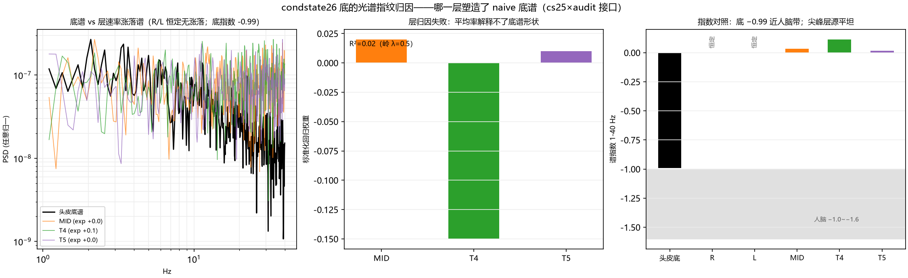

# bci/condstate26：底的光谱指纹归因——平均率层面失败（负结果 + 恒定层事实）

## 问题

cs25 定了底的"谁"（视觉通路暗适应层：L 强直 100%→MID 18 Hz→
T4/T5）；eegview 审计说 naive 底谱是最像人脑的（指数 −1.06）且
12 Hz 平台=视觉自发节律。诱人的下一步是"层速率涨落谱线性解释
底谱形状"——本弧检验它（零采集，cs25 的 floor_scalp +
floor_layers）。

## 结果（outputs/）



1. **底谱复现**（暗态无 chem）：指数 **−0.99**（与审计 −1.06
   一致），主峰 **11.5 Hz @12 dB**（审计的"12 Hz 平台"同源）；
2. **R/L 层恒定零方差**——R=0（暗）与 L=100%（强直）在 17 s
   稳态窗内逐 ms 恒定，无任何涨落；**底的涨落全部来自
   MID/T4/T5 的尖峰放电**；
3. **平均率归因失败（负结果）**：MID/T4/T5 的群体平均率涨落谱
   （指数 +0.03/+0.11/+0.02，平坦）岭回归解释底谱 R²=**0.02**
   ——**底谱形状（−0.99）不是任何层平均率谱的形状**；它由
   单神经元尖峰统计 × 前向投影（核加权求和）产生，群体平均
   把尖峰结构抹平了；
4. **峰位巧合（suggestive，不下结论）**：T5 平均率谱主峰
   11.1 Hz vs 底谱主峰 11.5 Hz——与 audit"12 Hz=视觉节律"的
   读法相容，但全局归因失败表明这一巧合不能当作证明。

## 语义

- 修正一个诱人的过度简化："底=视觉通路的率涨落投影"应读作
  "**底=视觉通路尖峰活动的投影**"——谱形状是尖峰级统计量
  （定时结构×核），不是平均率级；
- audit 的"naive 谱指数 −1.06 像人脑"因此更值得注意的是：
  这个 −1 指数由尖峰稀疏放电 + 平滑核自然产生，与静息皮层
  突触电流产生 1/f 的机制不同源（形状巧合，机制不同）；
- 对将来任何"层→头皮"归因分析的方法论警示：用平均率做谱
  归因会得到 R²≈0 的假阴性；需要尖峰级（或突触电流级）中间
  量。

## 诚实边界

- 单 trial 单种子；层平均率为 1 ms 群体均值（千级神经元平均，
  单神经元结构被抹除是设计使然——这正是本弧的论点）；
- 岭回归 λ=0.5 的线性归因是弱工具（只测"线性形状可解释性"，
  不排除非线性传递）；
- 11.5 Hz 峰与 T5 11.1 Hz 的巧合未做统计显著性（峰宽 ~1 Hz、
  单 trial，无意义可检）。

## 复现

```bash
# conda ffbm, repo root
python bci/condstate26/floor_spectra.py    # 需先有 cs25 outputs
# -> outputs/floor_spectra.png, outputs/floor_spectra_stats.json
```
