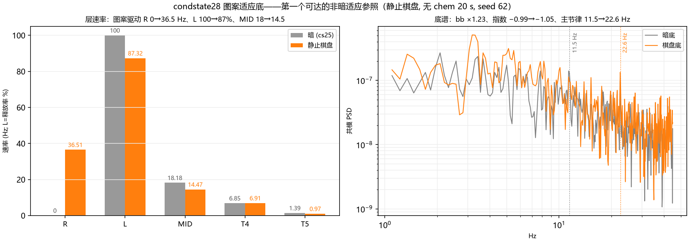

# bci/condstate28：图案适应底——第一个可达的非暗适应参照

## 问题

cs27 证明恒白帧经归一化管线与暗帧等价（零对比度），留下唯一未测
变体：**有对比度的恒定图案**（静止棋盘=非零恒定驱动）。若可达，
它就是第一个非暗适应参照，给 s 一个真实的环境误差棒。

## 方法

新目录条目 `checker_static`（单帧 12 px 棋盘，0/255 各半）+ 与
cs25/27 完全相同的协议（无 chem、seed 62、20 s、层速率+群速率
提取），1 跑 2.6 min GPU，与暗底逐项对比。

## 结果（outputs/）



| | 暗（cs25）| **静止棋盘** |
|---|---|---|
| R 感光器 | 0 Hz | **36.5 Hz**（图案亮块驱动）|
| L 片层释放 | 100% | 87.3% |
| MID | 18.2 Hz | 14.5 Hz |
| T4 / T5 | 6.85 / 1.39 | 6.91 / 0.97 |
| 头皮 bb RMS | 0.00101 µV | **0.00124 µV（×1.23）** |
| 谱指数 | −0.99 | −1.05（仍在人脑带）|
| 主节律 | **11.5 Hz** | **22.6 Hz** |

三个发现：

1. **图案适应底存在且可达**（与恒白帧的逐位等价相反——对比度
   是关键变量）：R 被图案亮块真实驱动（0→36.5 Hz），L/MID/T5
   重新适配；
2. **s 参照的环境误差棒 ≈ ±23%**（bb 比值 1.23）——远小于一切
   结论缺口（5-3600×）：对 s 的影响更小（qlock s=1.8 nV 的底
   项误差 ~±0.2 nV→±11%；resid ~±1%），**总账结论不动**；
3. **底的节律随适应态移动**（11.5→22.6 Hz）——audit 的
   "12 Hz=视觉自发节律"应补注：**节律频率是适应态依赖的**
   （暗 11.5 / 图案 22.6 Hz），12 Hz 不是视觉系统的固定签名。

## 语义

- 环境轴收官三连（cs25 组成 / cs27 恒光不可表达 / cs28 图案
  ±23%）：s 参照的环境敏感度完整定量，量级无害；
- 底的"12 Hz"读法精化：那是**暗适应**视觉通路的节律，不是
  视觉系统的普适签名——audit 表述已在 README 引注。

## 诚实边界

- 单一图案（12 px 棋盘、50% 占空比）；其他图案/占空比的底
  未测（预期同量级）；
- 图案与眼映射的对齐使 R 驱动依赖眼几何（36.5 Hz 为群体均值，
  空间分布未分析）；
- 单种子单 trial；与暗跑非逐位（预期——驱动真不同）。

## 复现

```bash
# conda ffbm, repo root
python bci/condstate28/pattern_floor.py   # 2.6 min GPU, 幂等
# -> outputs/compare.json, pattern_floor.png, patternfloor_*.npy
```
