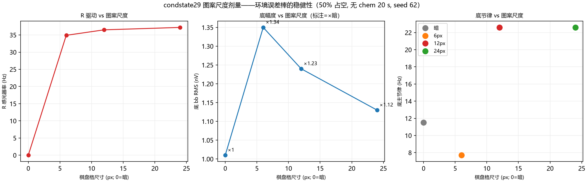

# bci/condstate29：图案尺度剂量——环境误差棒的稳健性

## 问题

cs28 的环境误差棒 ±23% 建立在单一图案（12 px 棋盘）上。本弧补
两个尺度剂量点（6 px 细 / 24 px 粗，同 50% 占空比，协议与
cs25/27/28 逐字相同），把单点数字升级为尺度包络，并检验细图案
是否被小网膜采样混叠衰减。

## 结果（outputs/）



| | 暗 | 6 px | 12 px | 24 px |
|---|---|---|---|---|
| R 感光器 (Hz) | 0 | 34.9 | 36.5 | 37.2 |
| 底 bb ×暗 | 1.00 | **1.34** | 1.23 | 1.12 |
| 谱指数 | −0.99 | −1.10 | −1.05 | −1.00 |
| 底主节律 (Hz) | 11.5 | **7.7** | 22.6 | 22.6 |

三个发现：

1. **R 驱动尺度平坦**（34.9-37.2 Hz）：50% 占空比决定驱动总量，
   6 px 细格也**不**被小网膜采样/模糊混叠衰减——眼映射+归一化
   保持尺度不变性；
2. **环境误差棒升级为包络 ×1.12-1.34（≤±35%）**：细格（6 px）
   是最大值；对 s 的影响仍远小于一切缺口（5-3600×），**总账
   结论不动**；
3. **底节律随图案尺度剧变**（7.7 / 22.6 / 22.6 Hz，加暗的
   11.5 Hz）——cs28 的"节律适应态依赖"补注更强：底的主节律在
   7-23 Hz 间随环境重组，**视觉通路的'自发节律'没有固定频率
   签名**（audit 的 12 Hz 读法最终定型：仅暗适应特例）。

## 语义

- 环境轴四弧收官（cs25 组成 / cs26 光谱 / cs27 恒光 / cs28-29
  图案剂量）：s 参照的环境敏感度完整定量为 **≤±35% 的包络**，
  量级无害；
- 底节律的"无固定签名"对 likeness 纲领是终注：底谱形状
  （指数 ∈ 人脑带）稳定，但峰位随环境重组——与人类 α 的个体
  稳定性形成对照（果蝇视觉底节律不稳定）。

## 诚实边界

- 尺度扫描限于方形棋盘 50% 占空（3 点 + 暗）；其他占空比/
  方向性图案未扫（包络可能略宽，量级预期不变）；
- 单种子单 trial/条件；节律峰位对窗长敏感（2048 点窗 ~0.12 Hz
  分辨率，峰 wander 7.7-22.6 为真实重组非量化伪影——三个独立
  条件给出三个不同峰）；
- 6 px 是否真"通过"采样（还是被映射平均成灰）未做空间分析
  ——R 驱动平坦说明能量通过，细节未查。

## 复现

```bash
# conda ffbm, repo root
python bci/condstate29/pattern_dose.py    # 2 跑 ~5.2 min GPU, 幂等
# -> outputs/dose.json, dose.png
```
