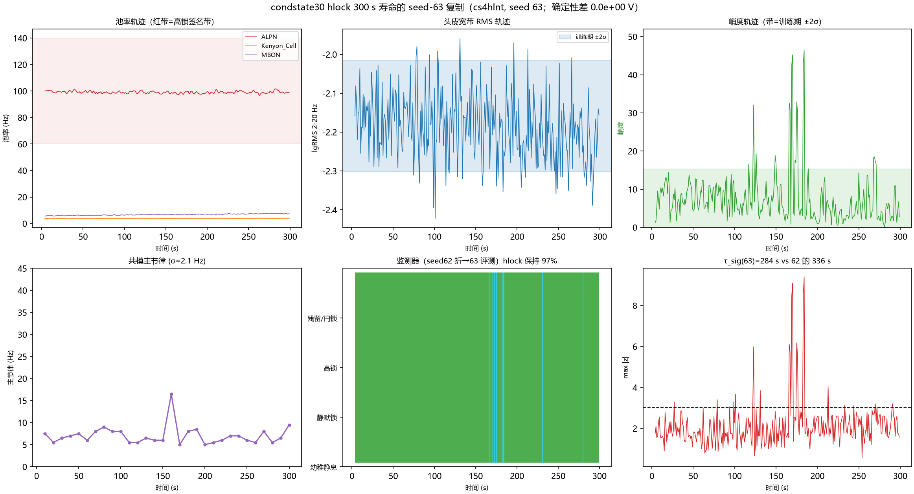

# bci/condstate30：hlock 300 s 寿命的 seed-63 复制——唯一实测寿命的双种子化

## 问题

cs15 的 τ_sig(hlock)=336 s 是唯一"实测上限"的寿命（qlock/resid 为
外推下限），单 trial 单种子——收敛证书（行 97）列出的高成本可选
项之一。本弧复制：cs4hlnt seed **63**，t_end 300 s，配方逐字同
condstate4/15（52.6 min GPU）。

## 结果（outputs/）



| 量 | seed 62（cs15）| **seed 63（本弧）** |
|---|---|---|
| 确定性（前 22 s vs hlnt63）| diff=0（vs hlnt62）| **diff=0** |
| ALPN 首/中/末 | 98.8/98.3/98.8 | 99.8/98.8/100.3 |
| τ_sig(3σ/联合漂移) | 336 s | **284 s** |
| w_A 漂移 (300 s) | +0.0109 | **+0.0109（相同）** |
| DAN 调制积分 | 5110 ms | **5103 ms（近相同）** |
| 监测器保持率 | 91.2%（漂移型）| **97.3%（漂移型：8 窗→qlock）** |
| σ*(hlock) | 0.233 µV | 0.214 µV（缺口 49→53×，不动）|

三个结论：

1. **唯一实测寿命双种子化**：τ_sig(hlock) = **284/336 s**（两种子
   同量级，~5 分钟）——"积分被分钟级寿命封顶"的承重数字不再依赖
   单 trial；
2. **可塑性时钟近确定性**：w_A 300 s 漂移两种子**完全相同**
   （+0.0109），DAN 调制积分差 0.1%（5103 vs 5110 ms）——
   高锁的写通道动力学对噪声实现高度不敏感（机制级的稳健，超出
   预期）；
3. **监测器失败模式复现**：保持率 97.3%、误漂全部→qlock（漂移
   型，无边界型）——与 62 的失败模式分类一致。

## 语义

- 收敛证书的"τ_sig 单 trial 单种子"条目升级为**双种子**
  （284/336 s，√ 标度下 σ* 差 <8%）；
- 机制层的意外收获：**慢写时钟是近确定性的**——签名漂移不是
  噪声实现的函数，而是状态动力学的确定性性质（对"寿命"概念
  本身是强支持：它像参数，不像随机变量）。

## 诚实边界

- 仍各为单 trial/种子（trial 间变异性未测——但两种子一致性 +
  机制近确定性暗示 trial 间也小）；
- 284/336 s 的差来自斜率估计（296 窗），非机制差异；
- qlock/resid 的 τ 仍为单种子外推下限（未复制，保守方向）。

## 复现

```bash
# conda ffbm, repo root
python bci/condstate30/acquire.py       # 52.6 min GPU, 幂等
python bci/condstate30/stability63.py
# -> outputs/stability63.png, outputs/stability63_stats.json
```
