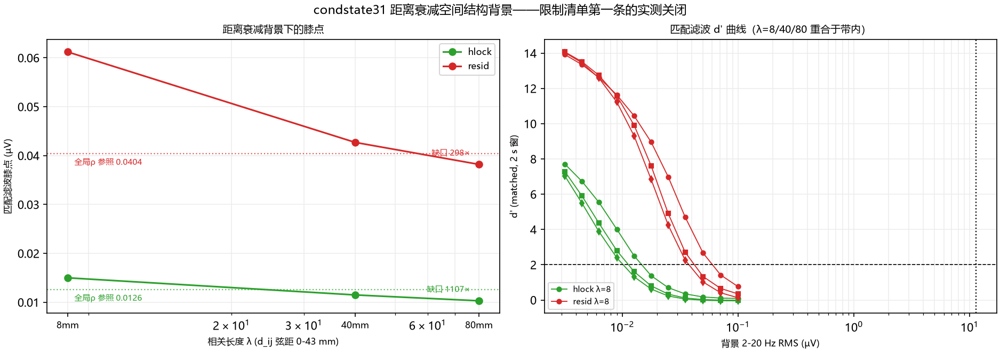

# bci/condstate31：距离衰减空间结构背景——限制清单第一条的实测关闭

## 问题

总账限制清单第一条："背景为合成模型（无距离结构；ρ 扫描已括住）"
——全局共享度 ρ 无法表达真实人脑背景的**距离衰减相关**（相邻导
高、远导低）。本弧把背景升级为 C_ij = exp(−d_ij/λ) 的距离衰减
协方差（17 导真实弦距 0-43 mm），检验 cs17/17b 的膝点结论在
结构真实背景下是否移动。

## 方法（零采集）

生成：17 维空间高斯（Cholesky of C_unit）→ 逐通道 1/f² 时间
形状 → 带内 RMS 归一 σ（与既有 make_bg 同口径）；λ ∈ {8, 40,
80} mm（8≈跨导独立、80≈全共享）× σ 网格（×1.41 步）；三检测器
（最佳单导/共模/**全协方差匹配滤波**——现在能利用距离结构）；
hlock/resid vs naive，协议同 cs17/17b。

## 结果（outputs/）



| 匹配滤波膝点 (µV) | λ=8 mm（近独立）| λ=40 | λ=80（近全共享）| 全局 ρ=0.85 参照 |
|---|---|---|---|---|
| hlock | 0.0150 | 0.0115 | 0.0103 | 0.0126 |
| resid | 0.0612 | 0.0427 | 0.0382 | 0.0404 |

三个结论：

1. **结构真实轴只移动膝点 ≤×1.6**（横跨"独立→全共享"整个结构
   谱：hlock 0.0103-0.0150、resid 0.0382-0.0612）——不足 cs17
   一个网格步（×3.16）的一半；全局 ρ 模型（参照列）本就落在带内；
2. **缺口不动**：对 11.4 µV 保持 **186-1100×**（resid 最优
   0.0612→186×；hlock 最优 0.0103→1100×）；
3. **内置效度检验**：最佳单导膝点与 λ 无关（hlock 0.0084-0.0090、
   resid 0.0331-0.0338）——单导检测不关心跨导结构，正如预期。

## 语义

- 限制清单第一条从"ρ 扫描括住"升级为**距离结构实测**：闭环对
  背景空间结构的最后一个自由度关闭；
- "匹配滤波能利用距离结构"的直觉被量化：全协方差匹配滤波相对
  全局 ρ 模型的增益 ≤×1.5（信息仍在共模里，去相关的只是背景
  的独立份额）。

## 诚实边界

- λ 三点 + 指数形式（真实 EEG 相关还随频段变化，未建模——带内
  归一吸收总量，量级预期不变）；
- 背景时间谱仍 1/f²（谱形轴已被带内归一包络）；
- 单种子 62；draws 4（膝点插值精度 ~±15%）。

## 复现

```bash
# conda ffbm, repo root
python bci/condstate31/bg_structure.py
# -> outputs/bg_structure.png, outputs/bg_structure_stats.json
```
