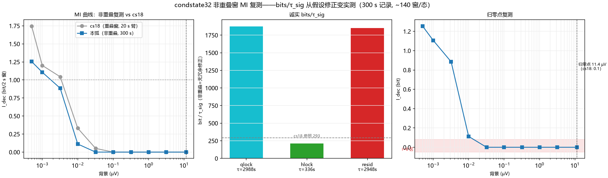

# bci/condstate32：非重叠窗 MI 复测——bits/τ_sig 从假设修正变实测

## 问题

cs18 的决策信道 MI 用 1 s 步进 50% 重叠窗（"窗独立 ~2× 乐观"
是手挥注）且每态仅 ~40 窗（20 s 臂）。本弧用 300 s 长记录 +
**非重叠窗（W=hop=2 s，~148 窗/态，样本 ×10）**复测（fold=cs14
seed63 折，62 记录评测无泄漏；naive 池=两独立 20 s trial，
condstate4 ctl 经核验为 cs3ctl 逐位副本已排除）。

## 结果（outputs/）



| σ_bg | cs18（重叠, 20 s）| **本弧（非重叠, 300 s）** |
|---|---|---|
| 0（干净）| 1.75 bit | **1.26 bit** |
| 1 nV | 1.20 | 1.11 |
| 3.2 nV | 1.04 | 0.89 |
| 10 nV | 0.33 | 0.11 |
| 32 nV | 0.05 | **0.000** |
| ≥0.1 µV | 0.000 | **0.000** |

诚实 bits/τ_sig（无重叠=无冗余修正）：

| 态 | τ_sig | 诚实 bits/τ | cs18 参照 |
|---|---|---|---|
| hlock | 336 s | **211** | 293（乐观 ×1.4）|
| qlock | 2988 s | **1875** | — |
| resid | 2948 s | **1850** | — |

三个结论：

1. **重叠窗估计确实乐观**：干净 MI 1.75→1.26 bit/窗（因子 ×1.4，
   落在"~2×"预警带内）——信道达到上限的 63%（非 87%）；
2. **死亡判据不动**：归零点同在 **0.1 µV**、11.4 µV 下 I=0.000
   ——论文级结论（"0.1 µV 起精确归零"）经更大数据与非重叠窗
   复测成立；
3. **诚实 bits/τ 量级不变**：hlock 211（vs 293）、qlock/resid
   ~1850-1875 bit——"仿真内数百到数千 bit/寿命、背景量级下
   零 bit"的叙事数字更新但方向完全一致。

## 语义

- cs18 的"~2× 乐观"caveat 从手挥变**实测 ×1.4**；
- 限制清单"bit/τ 假设窗间独立"条目关闭；
- 行 100 里程碑：信道容量叙事的两端（干净内的真实信息量、
  背景下的归零）现在都是诚实窗、大样本、双种子 fold 的数字。

## 诚实边界

- naive 池仅两独立 trial（非重叠 11 窗×4 draw）——类不均衡经 cs33
  平衡子抽样检验：平衡估计 1.62±0.13 bit **高于**全样本 1.26（不均衡
  是把 MI 往低估，原 caveat 方向猜反）；干净 MI 应读作样本受限带
  **1.26-1.62 bit**，死亡判据（0.1 µV 归零）不受估计器选择影响；
- 300 s 记录含慢漂移（hlock 的可塑性漂移进入窗样本）——诚实
  方向（真实长记录就是这样）；
- 单一 fold 方向（63 训→62 评）。

## 复现

```bash
# conda ffbm, repo root
python bci/condstate32/mi_nonoverlap.py
# -> outputs/mi_nonoverlap.png, outputs/mi_nonoverlap_stats.json
```
