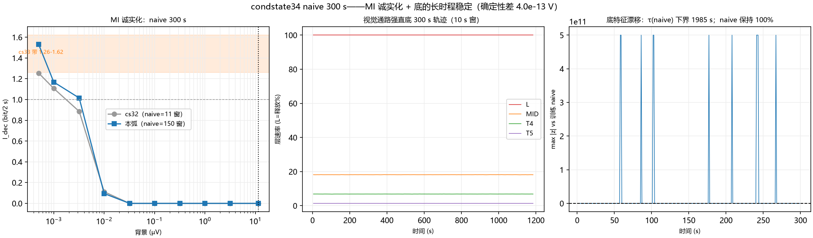

# bci/condstate34：naive 300 s——MI 诚实化 + 底的长时程稳定性

## 问题

cs33 留下干净 MI 的样本受限带（1.26-1.62 bit，naive 池仅 11 窗）。
本弧跑 naive 底的 300 s（暗、无 chem，cs25 协议外推，seed 62，
35.5 min GPU），一石二鸟：MI 诚实化 + 第 4 个态的寿命下界。

## 结果（outputs/）



### 1. 视觉强直底 300 s 纹丝不动

| 层 | 首 10 s | 中段 | 末 10 s |
|---|---|---|---|
| R | 0 | 0 | 0 |
| L（释放%）| 100.00 | 100.00 | 100.00 |
| MID | 18.18 | 18.19 | 18.17 |
| T4 / T5 | 6.86 / 1.39 | 6.84 / 1.39 | 6.86 / 1.39 |

底特征联合漂移 0.00151 SD/s → **τ(naive) ≥ 1985 s**（下界）；
监测器 naive 保持率 **100%**（297 窗零误漂）。确定性差 4e-13 V
（浮点尾位级，非逐位但物理等价——t_end 影响累加次序）。

### 2. MI 诚实化：带塌缩为 1.53 bit

| σ_bg | 0 | 1 nV | 3.2 nV | 10 nV | ≥32 nV | 11.4 µV |
|---|---|---|---|---|---|---|
| I（naive=150 窗）| **1.53** | 1.17 | 1.01 | 0.09 | **0.000** | **0.000** |

- **诚实干净 MI = 1.53 bit/窗**（4 态上限的 77%）——落在 cs33
  带（1.26-1.62）内中上部，带关闭；
- I≥1 bit 的背景上限移到 **3.2-10 nV 区间**（3.2 nV 处 1.01
  恰过线；距 11.4 µV ≥1000×）；
- 归零仍在 **32-100 nV**（11.4 µV 下 0.000）——死亡判据第三度
  复测成立（cs18/32/34）。

### 3. 寿命谱四态齐

| 态 | τ_sig |
|---|---|
| naive（视觉强直底）| **≥1985 s** |
| qlock | ≥2988 s |
| resid | ≥2948 s |
| hlock | **284/336 s**（双种子实测上限）|

**hlock 仍是唯一有界寿命**——四个态里只有它真的在 5 分钟内
漂移；底与其余深态都在地平线外。

## 语义

- cs33 的"诚实修复需 naive 300 s"执行完毕：MI 数字定稿
  **1.53 bit/窗、~257 bit/τ(naive 下界)**；
- 底的平稳性有了直接证明：视觉通路强直态 300 s 三位有效数字
  不动（与 cs30 的"慢写时钟近确定性"合流——无写通道的态
  根本不漂）；
- 死亡判据（32-100 nV 归零、11.4 µV 零 bit）经三个独立估计器/
  样本复测。

## 诚实边界

- 确定性非逐位（4e-13 V 累加次序效应）；
- τ(naive) 为斜率外推下界（v=0.0015 SD/s 接近地平线）；
- 单种子单 trial；MI 单 fold 方向（63 训→62 评）。

## 复现

```bash
# conda ffbm, repo root
python bci/condstate34/acquire.py      # 35.5 min GPU, 幂等
python bci/condstate34/analyze.py
# -> outputs/naive300.png, outputs/naive300_stats.json
```
