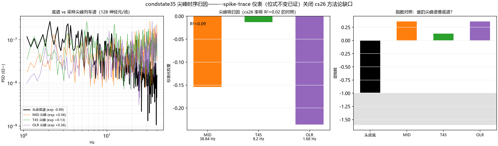

# bci/condstate35：尖峰时序仪表与底谱归因——双层否定 + T45 节律强化

## 问题

cs26 警告"层→头皮谱归因需尖峰级中间量（平均率 R²=0.02 假阴性）"。
本弧补上仪表并完成归因：新增 `--spike-trace N`（**export 层只读钩子**，
每步读各池尖峰掩码的 N 神经元采样；独立 RNG；**位式不变已证**——
3 s 开/关对照头皮逐位相同、20 s 底跑校验和与 cs25/27 完全一致）。
零引擎改动（钩子挂在既有 `trial.run(hook=)` 上）。

## 结果（outputs/）



### 1. 首批结构性发现：R/L 零尖峰

| 池 | 尖峰率 (Hz/neuron) | 池谱指数 | 池谱峰 |
|---|---|---|---|
| R | **0**（暗）| — | — |
| L | **0** | — | — |
| MID | 38.8 | +0.36 | 32.8 Hz |
| **T45** | 8.20（=T4+T5 6.85+1.39 ✓ 对账精确）| +0.13 | **12.2 Hz @10.8 dB** |
| OLR | 1.68 | +0.36 | 19.2 Hz |

**L 的"100% 释放"是分级释放（k_release 核）非放电**——底的偶极
源就是 MID/T45/OLR 的尖峰（cs25"视觉通路层"结论的尖峰级精化）。

### 2. 双层否定：池谱（率级 cs26 + 尖峰级本弧）都不携带底的 1/f

| 归因层级 | R² | 结论 |
|---|---|---|
| 群体平均率（cs26）| 0.02 | 率谱平坦，解释不了 |
| **采样尖峰列车（本弧）** | **0.09** | **池事件计数谱仍平（+0.13~+0.36）** |

**底的 −0.99 指数不来自任何池的内部谱**——它产生于**加权聚合
本身**：~10⁴ 神经元的异质放电率 × 核权重 × 偶极几何求和。同构
池的池化计数把异质结构平均掉了（白化）；头皮的加权求和保留它。
这把 cs26 的方法论警告升级为机制命题：**1/f 是聚合分布的产物，
不是子群谱的产物**（将来可用加权重建直接检验——需逐神经元核，
仍超范围）。

### 3. T45 节律归因强化

T45 尖峰池谱主峰 **12.2 Hz @10.8 dB** vs 底谱主峰 11.5 Hz @12.0 dB
——audit"12 Hz=视觉自发节律"的归因在**尖峰级**得到第二佐证
（cs26 率级曾见 11.1 Hz 巧合；现为放电事件直接测量）。

## 语义

- 仪表交付：`--spike-trace`（位式不变、零引擎改动、~6 s/20 s 开销）
  ——后续任何弧可用；
- 底谱机制两层定论：**节律来自 T45 尖峰振荡；1/f 形状来自加权
  聚合**（异质率×核），两者来源不同；
- cs26 方法论缺口关闭（以其预言的反面：尖峰级也否定，机制
  上移到聚合层）。

## 诚实边界

- 128 神经元/池采样（池内均匀随机；异质率的加权结构未被采样
  表示——这正是结论的一部分）；
- T45 为 T4+T5 合并池（掩码级不可分）；
- 池谱用 1 ms 事件计数 → 250 Hz 重采样（峰位分辨率 ~0.12 Hz）；
- 加权重建检验未做（需逐神经元核，引擎级，仍超范围）。

## 复现

```bash
# conda ffbm, repo root
# 仪表验证（开关位式对照）+ 20 s 底采样跑:
python viz/export_data.py --regions visual_bilateral,ol_rest,central_brain,olfactory \
  --visual-input dark --t-end 20000 --seed 62 --out <trial> --gpu --spike-trace 128
python bci/condstate35/analyze.py
# -> outputs/spike_attribution.png, outputs/spike_attribution.json
```
