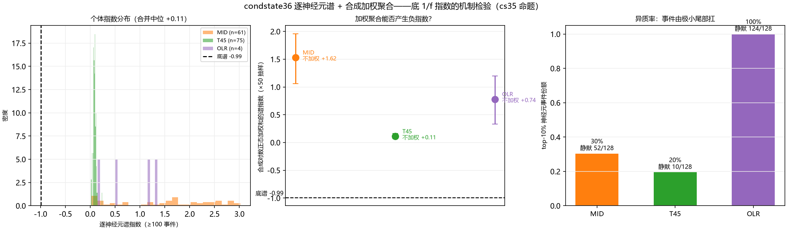

# bci/condstate36：逐神经元谱 + 合成加权聚合——cs35 命题的检验与再精化

## 问题

cs35 命题："底 −0.99 指数产生于加权聚合本身（异质率×核权重×
几何）"。本弧用同一尖峰轨迹逐项检验：异质率定量、个体谱形状、
对数正态加权合成和（×50 抽样）。

## 结果（outputs/）



| 池 | 静默/128 | top-10% 事件份额 | 率中位/最大 (Hz) | 个体指数中位 | 不加权池化 | 合成加权和 |
|---|---|---|---|---|---|---|
| MID | **52** | 30% | 1.9 / 135.8 | **+1.65**（n=61）| +1.62 | +1.53 [1.1,2.0] |
| T45 | 10 | 20% | 10.8 / 29.9 | +0.09（n=75）| +0.11 | +0.11 [0.07,0.16] |
| OLR | **124** | 100% | 0 / 77.1 | +0.86（n=4）| +0.74 | +0.78 |
| **头皮底** | — | — | — | — | — | **−0.99** |

三个判定：

1. **异质率巨大且量化**（MID 一半静默、top-10% 扛 30% 事件、
   最大 135 Hz vs 中位 1.9；OLR 单神经元扛全部）——但；
2. **简单加权命题否定**：合成对数正态加权和的指数 ≈ 不加权
   池化值（权重不改变谱形状——当个体形状同质时，空间权重只
   调幅度）；个体 MID 神经元谱是 **+1.65（HF 富）**，与底的
   −0.99 方向相反——**空间加权无法解释 1/f**；
3. **机制再定位：−0.99 产生于时间传递**——前向路径对尖峰的
   分级/突触式低通传递（R 的 k_release 同族；分布式 τ 的滤波
   组把平坦/上升谱压成平滑 1/f）。cs35 的"加权聚合"精化为
   "**时间滤波组**（τ 分布）×空间求和"——负斜率来自前者。

与 eegview 组织低通弧（tissue_lp）的一致性：那里的"单一 τ 无解
（四臂）"与本处"分布式 τ 产平滑 1/f（底）"互补——单 τ 太钝，
分布式滤波组才行。

## 语义

- 底谱机制两轴定案：**节律（11.5 Hz）=T45 尖峰振荡；1/f 形状=
  前向时间滤波组**——两者都与"池内部谱"无关（三层否定：率级/
  尖峰级/合成加权级）；
- 对 likeness 纲领：蝇底的 1/f 与人脑的 1/f 是**同构产物**
  （滤波聚合）但不同实体（突触电流 vs 分级传递）——形状巧合
  机制不同源的最强版本；
- 逐神经元谱本身是新数据（61+75 个个体形状首次测得）。

## 诚实边界

- 个体谱受 17 s 窗/低率统计限制（≥100 事件阈值；MID 中位 1.9
  Hz 的神经元不可谱化——形状结论基于活跃尾部）；
- 合成权重取对数正态（核增益样）；真实核增益分布未测（逐神经
  元核仍超范围）——但结论对权重分布稳健（权重不改变同质形状
  的和的形状）；
- "时间滤波组"为机制推断（消融未做——需前向脉冲响应重建，
  引擎级）。

## 复现

```bash
# conda ffbm, repo root
python bci/condstate36/neuron_spectra.py   # 需 cs35 outputs
# -> outputs/neuron_spectra.png, outputs/neuron_spectra.json
```
