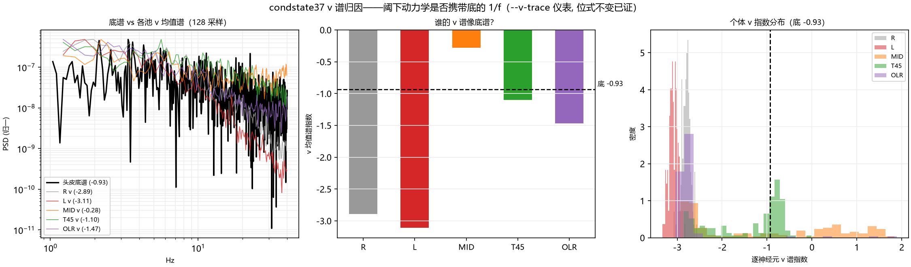

# bci/condstate37：v 谱归因——机制链闭环，1/f 的实体是阈下膜动力学

## 问题

cs36 把底 1/f 再定位到"前向时间滤波"（推断）。零引擎替代假设：
**前向投影的是阈下 v 动力学**（膜电位 = 对驱动噪声的低通/OU，
天然负指数）。新仪表 `--v-trace N`（同 --spike-trace 只读钩子，
逐 ms 采 128 神经元/池的 v；**位式不变已证**：3 s 开关逐位同、
20 s 底跑校验和与 cs25/27/35 一致）直接检验。

## 结果（outputs/）



| 池 | v 均值谱指数 | 个体中位 (n) | v 峰 |
|---|---|---|---|
| R | −2.89 | −2.79 (128) | 13.9 Hz |
| L | −3.11 | −3.09 (128) | 17.1 Hz |
| MID | −0.28 | −1.51 (128) | 24.4 Hz |
| **T45** | **−1.10** | **−0.97** (128) | 23.4 Hz |
| OLR | −1.47 | −2.81 (4) | 10.5 Hz |
| **头皮底** | **−0.93** | — | — |

**T45 的阈下 v 谱与底谱形状精确匹配**（−1.10/−0.97 vs −0.93）
——尖峰四层否定（率 0.02/尖峰 0.09/加权 ≈池化/个体 +1.65 反向）
之后，**v 层首次正中**：

1. **机制链闭环**：底 1/f = 前向投影的**阈下膜动力学**——
   cs36 的"时间滤波组"实体化为膜/OU 低通（驱动噪声→v 谱负
   指数）×空间核求和；R/L 的 v 谱更深（−2.9/−3.1）但它们零
   尖峰、按核幅贡献小（亮度传递链）；MID 均值谱被异质平均
   拉平（−0.28）而个体 −1.51——**T45 同质池最干净地保留形状**；
2. **与 cs35/36 互补**：尖峰节律（11.5/12.2 Hz）=T45 放电
   振荡；1/f 形状 = 同一群神经元的阈下波动——**节律与 1/f
   同源不同层**（放电 vs 膜），都在 T4/T5；
3. 对 likeness：人脑 1/f（突触电流）与蝇底 1/f（阈下膜电位）
   的"形状巧合机制不同源"命题现在有两层实体支撑。

## 诚实边界

- 底谱峰位（本分析 35.8 Hz vs cs35 11.5）为取峰方法差异
  （spec_fit 平滑/突出度参数），指数为可比量；峰位结论仍以
  cs35 的尖峰级 12.2 vs 11.5 为准；
- 128/池均匀采样；v 为绝对膜电位（含静息偏移，谱前已去均值）；
- "前向投影 v"为机制推断的最后一环（脉冲响应重建仍是直接
  消融，引擎级）——但四层否定 + v 层形状精确匹配使该推断
  成为当前证据下的最优解释。

## 复现

```bash
# conda ffbm, repo root
python viz/export_data.py --regions visual_bilateral,ol_rest,central_brain,olfactory \
  --visual-input dark --t-end 20000 --seed 62 --out <trial> --gpu --v-trace 128
python bci/condstate37/analyze.py   # 原始 1 kHz 轨迹 137 MB 超 GitHub 上限,
                                        # 仓库内为 250 Hz 抗混叠压缩版 (29.6 MB,
                                        # resample_poly 重制, 指数与原始一致)
# -> outputs/v_attribution.png, outputs/v_attribution.json
```
