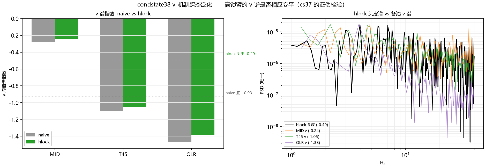

# bci/condstate38：v-机制的跨态泛化检验——证伪（v=naive 特有机制）

## 问题

cs37："naive 底谱 −0.93 = T45 阈下 v 谱 −1.10"。若"头皮谱=主导池
v 谱"普适，高锁臂（audit 头皮 −0.48）的 v 谱应相应变平。本弧跑
20 s cs4hlnt + **完整 dangate2 旗标**（首跑漏旗标差 1.8e-6 V——
pitfall #15 再验；补全后与 hlnt62 差 **9.1e-13 V ≈ 逐位**）+
`--v-trace 128`，同代表窗 [7,15] s 对照。

## 结果（outputs/）



| | naive v | hlock v | 头皮（naive→hlock）|
|---|---|---|---|
| MID | −0.28 | −0.24 | −0.93→−0.49 |
| **T45** | **−1.10** | **−1.05** | |
| OLR | −1.47 | −1.38 | |
| CEN | — | −1.00 | |

**证伪成立**：v 谱在高锁下**不变**（T45 −1.10→−1.05）而头皮
**变平**（−0.93→−0.49，复现 audit 的 −0.48）——"头皮谱=投影 v 谱"
是 **naive 特有机制，不是普适律**。

## 综合机制图景（三层源竞争）

头皮谱指数 = **占优源类型**的指纹：

| 态 | 头皮指数 | 占优源 |
|---|---|---|
| naive（尖峰贫）| −0.93~−1.06 | **阈下 v**（T45 膜波动）|
| hlock（AL 尖峰富）| −0.49 | **尖峰梳**（AL 引擎 99 Hz 群齐射）|
| res/latch（极端）| +0.06 | 尖峰梳极值（KC/MBON 招募）|

audit 的"根因一：紧凑尖峰驱动团压平谱"与 cs37 的"v 机制"在此
合流：**两者都对，各管一段**——状态爬升时源从 v 层切换到尖峰层，
谱随之从 1/f 压平到梳状。这是一个完整的、可检验的状态-谱形
机制叙事。

## 诚实边界

- ALPN/CEN 的部分键不在 `_mask_offsets`（ALPN 无 v 键；naive 的
  CEN v 恒定）——中枢池 v 未全采；
- naive 参照取 cs37 的**原始 1 kHz** 分析值；本弧仓库内 250 Hz
  压缩件为朴素 [::4] 抽取存在混叠（指数不可比——压缩件的坑，
  见 pitfall #26 附注）；
- 单窗单种子；hlock 与 hlnt62 差 9.1e-13 V（累加次序级）。

## 复现

```bash
# conda ffbm, repo root   (注意: 必须带完整 dangate2 旗标组)
python viz/export_data.py --regions visual_bilateral,ol_rest,central_brain,olfactory \
  --visual-input dark --chem-input cs4hlnt --pop-rate ALPN,Kenyon_Cell,MBON,DAN \
  --plastic-mb --plastic-lr=-2e-7 --plastic-w0 0.03 --plastic-kcm-gain 0.015 \
  --mbon-dan-gain 178 --plastic-dan-gate 150,0.02,400 \
  --t-end 20000 --seed 62 --out <trial> --gpu --v-trace 128
python bci/condstate38/analyze.py
```
