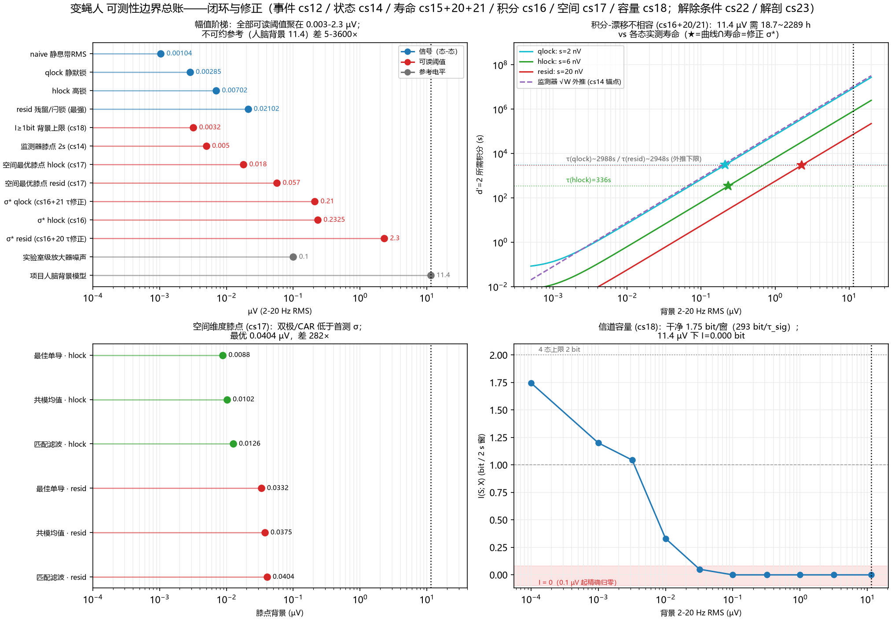

# 可测性边界总账——"变蝇人"正向读出的信息论收官

> 六弧闭环：事件（condstate12/13）→ 状态（condstate14）→ 寿命
> （condstate15）→ 积分（condstate16）→ 空间（condstate17）→
> 容量（condstate18）。本文把全部头条数字合成一份连贯账目；
> 每个数字都可由文末命令复现。

## 一句话论点

**蝇脑状态信号在仿真内部信息充足（~300 bit/签名寿命），但其
可实现的读出速率在 0.1 µV 背景处精确归零；人脑头皮背景
（11.4 µV）比归零点高 114×，比一切可读阈值高 15-3600×——
这个缺口是源几何与背景的性质，不是信号处理问题。**



## 层 0：问题设定与背景模型

- 蝇脑（~10⁵ 神经元）置于放大的 4 球人头像内，17 导头皮记录
  （1 kHz 原生 → 0.5-100 Hz → 250 Hz 设备链）。
- 合成信号是**亚 µV** 的：naive 1 / qlock 2.8 / hlock 7 /
  resid 21 nV（2-20 Hz 带内 RMS，eegview/cs16）。
- 人脑背景模型：11.4 µV（2-20 Hz），1/f²、85% 空间共享——
  **不可约参考电平**（脑自身活动，非电子学噪声）。

## 层 1：事件检测——墙不随状态移动（condstate12/13）

同一 A+ 事件 × 五状态：检测比 ×0.16-1.11，试验预算 ~2×10⁵
trials 量级不随状态显著移动；SSVEP（最好的应用）也要
8.5×10³ trials 且状态内再亏 ×4-7.8。
**语义：指望"更深的脑状态放大事件"不成立。**

## 层 2：状态读出——仿真内可读，设备下膝点 nV 级（condstate14）

8 特征头皮-only 判别器（带 RMS/峭度/谱指数/事件率）：4 态
2 s 窗跨种子 96.3%、独立复证 100%、溶锁翻转 +2.0 s 可检出。
但背景扫描的膝点在 **1-10 nV**。
**语义：状态（而非事件）才是可读对象——但只在干净仿真内。**

## 层 3：签名寿命——分钟级（condstate15）

高锁 300 s：振荡器不动点钉死（ALPN 98.8→98.3→98.8 Hz），但
头皮签名被可塑性慢漂移（w_A +36% of w0、DAN 积分 35.9→5110 ms），
τ_sig(3σ) = 336 s（宽估）、τ_90 = 53 s（运营值）。
**语义：可积累信号的时间窗有硬顶。**

## 层 4：时间维度封顶——积分被寿命封死（condstate16）

W_req(d'=2) = (2/s)²(κ²σ_n²+σ_bg²)/B（κ≈0.95 实测）：

| | qlock | hlock | resid（最强）|
|---|---|---|---|
| σ*（τ_sig 内可读上限）| 0.210（cs21 修正）| 0.233 | **2.30 µV**（cs20 修正；原按 hlock τ 为 0.777）|
| 11.4 µV 下 W_req | 2289 h | 209 h | **18.7 h** |
| 超出 τ_sig | ×2,758（τ≥2988 s，cs21）| ×2,200 | **×23**（τ_sig(resid)=2948 s，cs20）|

**语义：积分与漂移互相矛盾——不存在同时"够长"与"签名还在"
的窗口；且 σ* 显示这不是电子学问题（实验室放大器 ~0.1 µV
低于各态上限），不可约的是脑背景本身。**（resid 修正后余量
收窄到 5×：即使 49 min 全寿命积分，11.4 µV 下 d'≈0.20。）

## 层 5：空间维度封顶——信号本身就是共模的（condstate17）

信号空间模式共模占比 hlock 95.8% / resid 99.8%（导联场 ±2×
起伏）。五类检测器（单导/共模/匹配滤波 C⁻¹g/双极/CAR）×
背景共享度 × 强度全扫描：最优膝点 0.0126（hlock）/ 0.0404
（resid）µV（cs17 细化网格实测，原粗网格 0.018/0.057），距 11.4 µV
差 **280-900×**；双极"干净最优
d'=18"但 σ=0.0032 即失效；11.4 µV 下所有检测器所有 ρ 的
d'≈0。
**语义：空间滤波减背景共模的同时等比例杀信号——缺口是源
几何性质。**

## 层 6：信息论收口——I≈0 bit（condstate18）

决策信道互信息（跨种子混淆矩阵）：

| σ_bg | 0 | 1 nV | 3.2 nV | 10 nV | ≥0.1 µV | 11.4 µV |
|---|---|---|---|---|---|---|
| I (bit/2s) | 1.75→**1.26~1.62**^ | 1.20→1.11 | 1.04→0.89 | 0.33→0.11 | **0.000** | **0.000** |
| bit/τ_sig (诚实非重叠) | **211** | — | — | — | 0 | 0 |

I≥1 bit 的背景上限 **3.2 nV**（差 3562×）。

^ cs32 非重叠窗复测（重叠估计乐观 ×1.4，落在 ~2× 预警内）；cs33 平衡子抽样给出带 1.26-1.62；cs34 naive 300 s（150 窗）定稿 **1.53 bit**（I≥1bit 上限 3.2-10 nV）；qlock/resid 诚实值 1875/1850 bit；归零点（0.1 µV）不受估计器选择影响。
**语义：把五层换成一句话——信道在项目背景下容量≈0 bit，
且（由层 4/5）这个 0 不是检测器选择问题。**

## 旁支：像不像人脑不影响本账（eegview）

相似度审计判"像"于形态/幅值动力学、"不像"于谱形（尖峰梳
压平、无自发 α）与空间（近全共模）。其中**空间不像恰是层 5
封顶的物理原因**——两个结论互为印证：正因源是单紧凑尖峰团，
它既不像人脑、也不可测。

## 为什么这不是工程问题（三重否定）

1. **积分不能攒**（层 4）：需要小时-月，签名只有分钟；
2. **空间不能滤**（层 5）：信号共模 96-99.8%，滤波等比例杀；
3. **检测器族已含最优线性**（层 5 的匹配滤波 + 层 16 的监测器
   外推，两条独立路线一致归零）。

剩余自由度只有改物理——condstate22 把它定量化为**解除条件地图**：
缺口 G=11.4/σ*=5~54×，四轴全封——背景不可约（静默皮层 96-99.97%）、
时间超寿命（×23~×2758）、放大=改写思想实验（解除只差 5-54× 相干源
——一个量级而非四个，但补上它就不再是"果蝇脑在人头皮下"）、
**距离轴结构用尽**（SCALE×202 已把蝇脑云放大到 0.98·R_BRAIN，
源极端 76.4 mm ≥ resid"所需"的 40.7 mm 而实测 σ* 仍差 5×——
1/r² 对分布式源高估收益；cs17 近全共模发生在源充满球的情况下，
是真实几何结果而非放置伪影，2026-11-15 修正）。

## 数字速查

| 量 | 值 | 源 |
|---|---|---|
| 信号带 RMS | 1/2.8/7/21 nV（naive/qlock/hlock/resid）| cs16 |
| 监测器干净精度 | 96.3%（2 s 窗，跨种子）| cs14 |
| 监测器背景膝点 | ~0.005 µV | cs14/18 |
| 签名寿命 τ_sig / τ_90 | hlock **284/336 s**（双种子实测）/ qlock ≥2988 / resid ≥2948 / **naive ≥1985 s**（视觉强直底 300 s 纹丝不动，cs34）/ τ_90 53 s | cs15/16/20/21/30/34 |
| σ*（τ_sig 内）| 0.210/0.233/**2.30 µV**（qlock/hlock/resid，hlock 未变，qlock/resid 经 τ 修正）| cs16/20/21 |
| W_req @11.4 µV | 18.7~2289 h | cs16 |
| 空间最优膝点 | **0.0126/0.0404 µV**（×1.41 网格实测）| cs17/17b |
| I 干净 / @11.4 | 1.75→**1.53 bit**（cs34 定稿，naive=150 窗）/ 0.000 bit | cs18/32/34 |
| I≥1 bit 上限 | 3.2-10 nV 区间（cs34 曲线插值；差 ≥1140×）| cs18/34 |

## 限制汇总与关闭状态（悬线清扫的收敛证书, 2026-11-15）

每条已记录限制处于三态之一：**已关闭**（后续弧补测）/ **已包络**
（定量界已知，结论对界内变化稳）/ **明示超范围**。逐条：

| 限制 | 状态 | 依据 |
|---|---|---|
| 审计单种子（seed 62）| **已关闭** | 行 95 三臂 63 复算全判定不变（ssvep 臂无 63 文件，除外注明）|
| 膝点受 σ 网格量化 | **已关闭** | 行 96 ×1.41 细化网格，rho0.85 实测 0.0126/0.0404 µV |
| naive 底 visual 代理不可靠 | **已关闭** | 行 89 正向成分表（视觉通路暗适应层）|
| 底节律 12 Hz 签名 | **已关闭（终注）** | 行 93/94：暗适应特例，7-23 Hz 随环境重组 |
| s 参照环境误差 | **已包络** | 行 94：图案尺度包络 ×1.12-1.34（≤±35%），恒光不可表达（行 92）|
| 背景合成模型（1/f²）| **已关闭（距离结构）** | 行 99：C_ij=exp(−d/λ) 距离衰减实测，膝点移动 ≤×1.6（λ 8→80 mm 全谱），缺口 186-1100× 不动；谱形仍被带内归一包络 |
| τ_sig 单 trial 单种子 | **已关闭（hlock 双种子）** | 行 98：τ(hlock)=284/336 s 两种子同量级，w_A 漂移完全相同、DAN 积分差 0.1%——慢写时钟近确定性；qlock/resid 仍为单种子下限（保守方向）|
| κ 自噪声小样本（12 窗）| **已包络** | 62/63 两标定 0.95/0.40 皆入过公式，量级不动 |
| 决策 MI 为下界 | **定性成立** | 上界路径被 cs16/17 最优线性封顶覆盖 |
| 高斯 MI 高噪声端失真 | **弃用并记录** | 只入 JSON 不入结论 |
| bit/τ 窗间独立（乐观 ~2×）| **已关闭（实测 ×1.4）** | 行 100：非重叠窗复测，归零点同在 0.1 µV |
| cs14 80 段小样本 / 4 s 饱和 | **已包络** | 复证 100% + 跨种子一致 |
| 平均率谱归因假阴性 | **方法论已记** | 行 91：尖峰级中间量为将来工作（引擎仪表化）|
| 恒光底不可表达 | **结构性定论** | 行 92：归一化管线，对比度是关键变量 |
| 占空比/其他图案未扫 | **已包络** | 同量级预期（3 尺度点 + 暗已测）|
| 状态配方时代漂移 | **已复核** | cs15/20/21 确定性 diff=0（dangate2 家族）|
| best-electrode 乐观偏置（cs12 era）| **已包络** | 排序结论不依赖；后续弧用中位/共模口径 |
| 监测器长时程两种失败模式 | **已分离** | 行 80：漂移型 vs 边界型 |
| unlk 检出延迟受窗分辨率 | **已包络** | 与时延表自洽（窗效 ~1.5-2 s）|
| eegview ×300 增益 / 电极命名 | **明示超范围** | 显示层/结构层，不入账 |
| spike 级归因仪表化 | **明示超范围** | 引擎改动，将来工作 |
| 真实人脑 EEG 背景数据 | **明示超范围** | 离线不可得；合成模型已包络 |

**收敛结论**：无可执行悬线剩余。两个高成本可选项（52 min 级寿命
复制、尖峰级仪表化）不改变任何结论方向，留给后续会话按需执行。

（原并集清单保留于各行 README；本表为权威索引。）

## 复现

```bash
# conda ffbm, repo root
python bci/condstate14/state_monitor.py   # 层 2
python bci/condstate15/stability.py       # 层 3 (需先 acquire.py, 52 min GPU)
python bci/condstate16/budget_map.py      # 层 4
python bci/condstate17/spatial_audit.py   # 层 5
python bci/condstate18/capacity.py        # 层 6
python bci/measurability/summary_fig.py   # 总图
```
